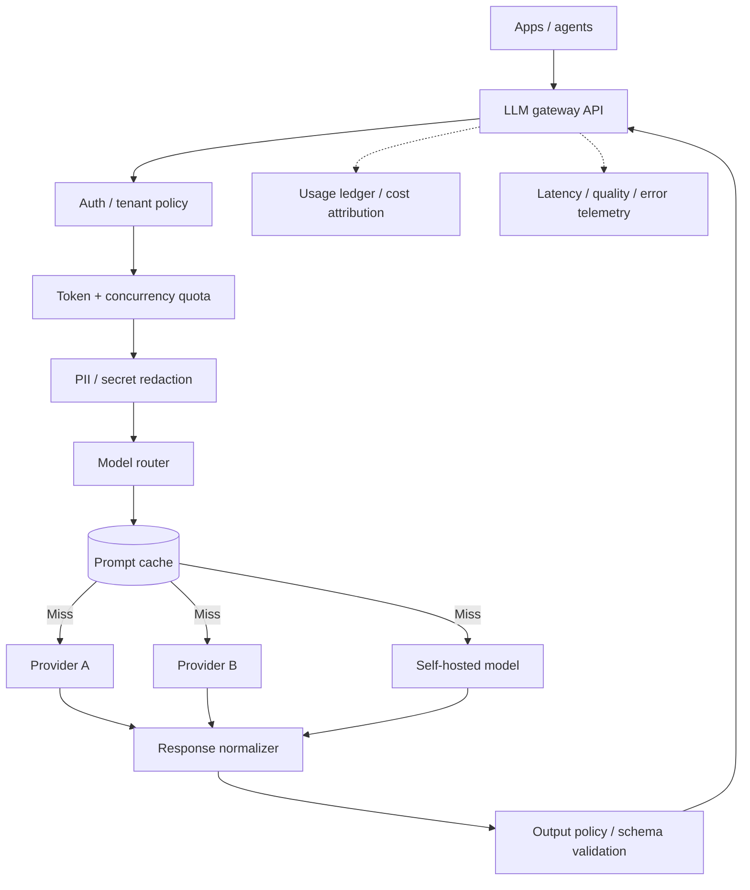
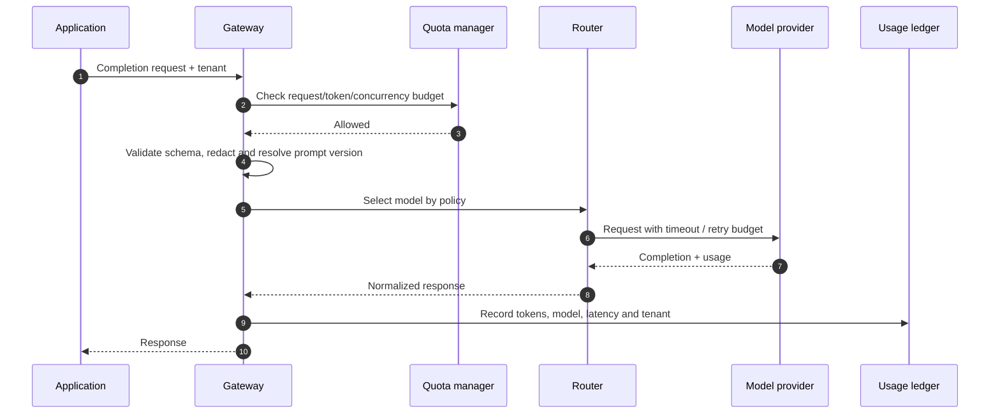

# LLM Inference Gateway — HLD Case Study

Build a shared gateway for multiple applications and model providers. Central concerns are policy, routing, token budgets, latency, fallback, evaluation and cost attribution.

## Architecture

## Request sequence

## Routing policy dimensions

- Task type and quality target.
- Model capability and context window.
- Per-tenant price ceiling and token budget.
- Data residency/privacy and provider allowlist.
- Latency target, concurrency and current provider health.
- Fallback model compatibility and output schema.

## Reliability and cost controls

- Distinguish retryable transport errors from non-retryable content/model errors.
- Apply bounded retries with jitter; avoid retry amplification across app and gateway.
- Stream responses where supported; propagate cancellation.
- Track prompt/completion tokens, cache savings, cost/task and provider throttles.
- Semantic cache must be tenant-scoped and respect prompt/model/data versions.
- Protect provider keys; callers authenticate to the gateway, not to providers.
- Model fallback is not semantically identical; record fallback and evaluate quality drift.

## Evaluation

Use a versioned request set to measure schema validity, task success, refusal correctness, grounding where relevant, latency, cost and safety. Compare provider/model versions with canary traffic before changing default routing.