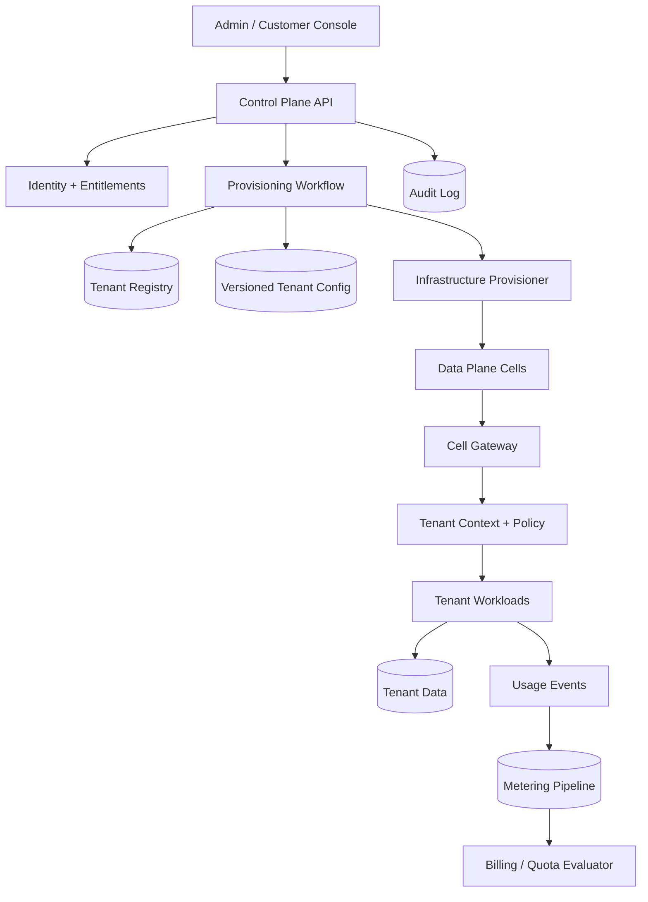
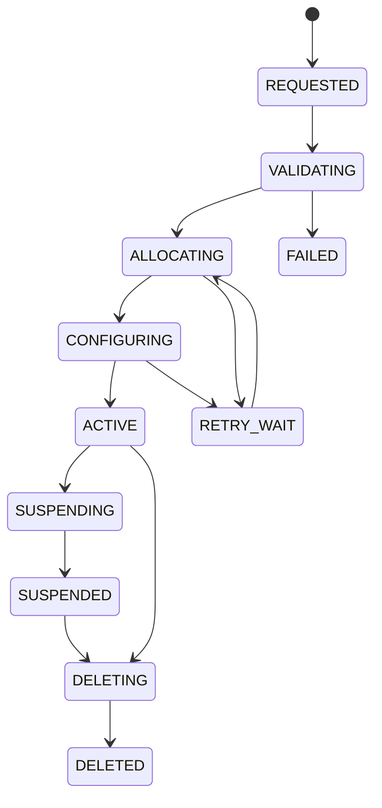

# Multi-Tenant SaaS Control Plane — HLD Case Study

> Focus: tenant provisioning, configuration, isolation boundaries, identity, metering, noisy-neighbor controls and control-plane/data-plane separation.

## Problem and requirements

Design a SaaS platform with customer workspaces. The control plane creates tenants, manages plans, policy and routing; data-plane services execute tenant workloads.

Functional: create/suspend/resume/delete tenants; configure plan limits, regions, entitlements and residency; provision asynchronously; authenticate and authorize memberships; meter usage; audit support access; migrate tenants between cells.

Non-functional: default isolation, control-plane outage must not stop healthy existing data-plane traffic, resumable provisioning, noisy-neighbor protection and explicit deletion guarantees.

## Isolation model

1. Shared tables with mandatory `tenant_id` and row-level security.
2. Schema/database per tenant for stronger logical isolation.
3. Dedicated cell/cluster for regulated or large tenants.

A tiered hybrid model is often practical. Include migration and operations cost in the decision.

## Architecture

## Request routing

Authenticate identity and resolve membership; validate tenant status and entitlement; resolve cell/region from a cached versioned registry; issue a signed context containing tenant, actor, role, policy version and expiry; cell gateway revalidates context; data access scopes every query/cache key by tenant. A client-supplied tenant ID is not authorization.

## Provisioning state machine

Each step has operation ID, idempotency, timeout, retry budget and compensation. Persist step state and emitted events. A reconciler compares desired tenant state with observed infrastructure and repairs drift.

## Data model

- `tenant(id, slug, status, plan_id, region, cell_id, config_version)`
- `tenant_membership(tenant_id, user_id, role, status)`
- `tenant_entitlement(tenant_id, feature, enabled, limit_value, version)`
- `tenant_config(tenant_id, version, config_json, created_by, created_at)`
- `provisioning_operation(id, tenant_id, operation, state, step, attempt, next_attempt_at)`
- `cell(id, region, capacity, health, routing_state)`
- `usage_event(id, tenant_id, dimension, quantity, occurred_at, source)`
- `audit_event(id, tenant_id, actor_id, action, target, reason, at)`

Audit is append-only. Deletion covers databases, indexes, objects, caches, backups and legal holds.

## Control plane vs data plane

Control plane: tenant configuration, provisioning, plans, identity policy and audit. It optimizes correctness and administrative workflows.

Data plane: high-volume tenant requests. It uses cached/versioned configuration and local enforcement. Existing tenants continue within a defined config-staleness budget during control-plane dependency outages.

## Noisy neighbors and quotas

Rate-limit per tenant/user/operation; allocate concurrency budgets; partition queues by tenant class; meter asynchronously but enforce hard quotas synchronously where required; use weighted fair queuing; detect hot tenants and rebalance cells. Define whether quota is hard reject, warning, overage billing or grace period.

## Migration and recovery

Snapshot/replicate data, replay change log, verify counts/checksums, pause or dual-write based on consistency needs, atomically change routing version, drain old cell and retain rollback window. Prevent split-brain with ownership lease/epoch. Align tenant-registry, config and data-plane RPOs; test tenant-level restore.

## Security and observability

Signed short-lived tenant context; DB row-level plus application checks; encryption; just-in-time support access with approvals; audit privilege use. Measure provisioning age, config staleness, routing errors, cross-tenant denial tests, per-tenant saturation, migration lag and deletion completion.

## Trade-offs

| Decision | Benefit | Cost |
|---|---|---|
| Shared DB | Efficient | Strict tenant-scope discipline |
| Dedicated DB | Stronger isolation | Cost and fleet complexity |
| Cached config | Resilient data plane | Staleness/invalidation |
| Async provisioning | Resumability | Eventual consistency |
| Cell architecture | Blast-radius control | Placement/rebalancing |

Senior follow-ups: migrate without downtime or split-brain; control-plane outage for 30 minutes; prove no leakage; accurate concurrent quota counters; deletion from backups/derived indexes.

Open the interview with the control-plane/data-plane boundary, then justify an isolation tier against security, cost and operations.
