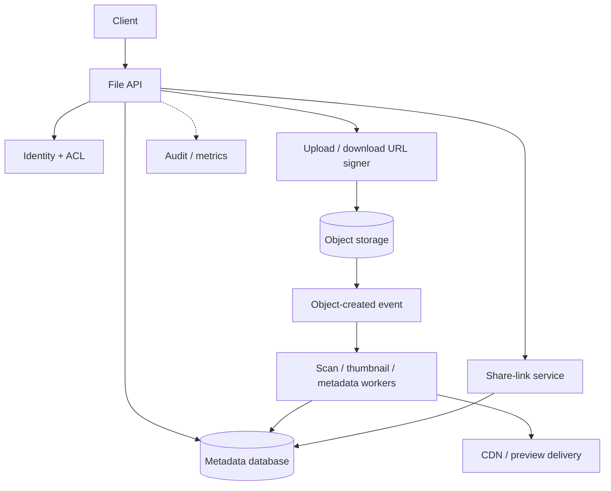
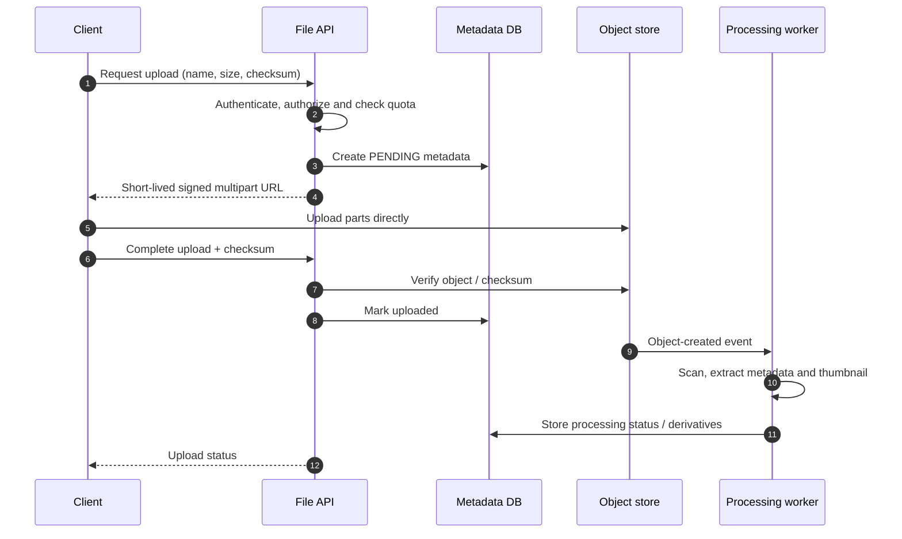

# Object Storage and File Sharing — HLD Case Study

Build a service for uploading, downloading, sharing and deleting large files. Separate metadata/permissions from file bytes.

## Core architecture

## Upload sequence

## Data model

- File(id, owner_id, object_key, size, checksum, content_type, state, created_at, deleted_at)
- ShareLink(id, file_id, token_hash, expires_at, permissions)
- Derivative(id, file_id, kind, object_key, version)

## Important design choices

- Clients upload directly to object storage via short-lived signed URLs; API does not proxy large bytes.
- Use multipart upload, checksum validation, maximum object size and abandoned-upload cleanup.
- Metadata DB is source of truth for ownership and authorization.
- Never expose raw object keys as authorization. Signed URLs must be short-lived and scoped.
- Processing workers are async, idempotent and safe to retry.
- Deletion must consider originals, derivatives, CDN caches, share links, retention and legal holds.
- Use malware scanning and content-type validation before public sharing.

## Failure modes

| Failure | Handling |
|---|---|
| Incomplete multipart upload | Lifecycle cleanup |
| Duplicate object event | Idempotent processing key |
| Processing failure | Retry + DLQ; preserve original upload |
| Leaked share URL | Expiry, revocation, token hash and audit |
| Metadata/object mismatch | Reconciliation job |