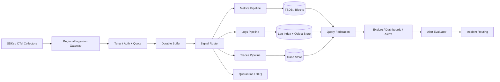
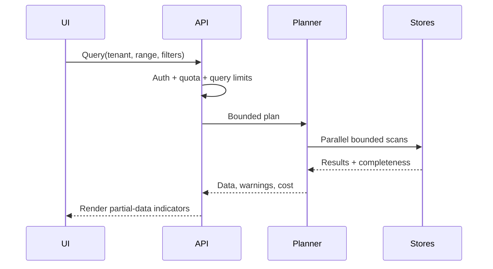

# Observability Platform — HLD Case Study

> Design a multi-tenant platform ingesting metrics, logs and traces with fast investigation, cardinality controls, retention tiers and predictable cost.

## Requirements and workload

Functional: OpenTelemetry ingestion, metric/log/trace query, dashboards, alert rules, tenant quotas, retention and export. Non-functional: burst tolerance, bounded query latency, tenant isolation, durable accepted telemetry and graceful overload behavior.

Illustrative workload: 10,000 services; 100k metric samples/s average (5x burst); 50k logs/s at 1 KB; 20k spans/s at 1.5 KB; 15-minute hot window and 7–30 day searchable tier. Series cardinality is active unique series, not sample rate. Avoid unbounded labels such as user IDs.

## Architecture

## Ingestion

Authenticate tenant and validate attributes; enforce per-tenant and per-signal quotas; batch and compress; use bounded queues/backpressure; buffer durably before acknowledging according to the durability tier; normalize schemas; reject or transform high-cardinality dimensions with explicit counters and audit. Separate malformed, unauthorized and over-quota paths.

## Storage selection

| Signal | Query pattern | Candidate store | Key |
|---|---|---|---|
| Metrics | Range scan, aggregation, downsampling | TSDB / columnar blocks | Time + series labels |
| Logs | Time + text/field filters | Object store + inverted index | Tenant + time |
| Traces | Trace ID lookup, service graph | Trace-oriented store | Trace ID + time |

Keep payload blobs separate from hot indexes. Tier retention, compact, downsample and expose partial results when cold storage is unavailable.

## Query flow

Alert evaluation should use separate resource pools from interactive queries. Specify evaluation window, no-data behavior, dedupe key, silence and escalation semantics.

## Tenant data model

- `tenant(id, plan, quota_policy, retention_policy)`
- `telemetry_usage(tenant_id, signal, bytes, samples, window_start)`
- `series_fingerprint(tenant_id, fingerprint, labels, first_seen, last_seen)`
- `alert_rule(id, tenant_id, query, window, threshold, version)`
- `alert_state(rule_id, group_key, state, last_evaluated_at)`
- `incident(id, tenant_id, dedupe_key, status, opened_at, resolved_at)`
- `retention_job(tenant_id, signal, cutoff, status)`

Tenant scope must be in query plans, storage keys and caches.

## Overload and failure

| Condition | Behavior |
|---|---|
| Ingestion burst | Bounded durable buffer; throttle or shed by priority |
| Quota exceeded | Explicit rejected/partial counts |
| Storage unavailable | Retry from durable buffer; cap backlog age/disk |
| Cardinality explosion | Quarantine dimensions, alert owner, enforce guardrails |
| Query fanout overload | Per-tenant concurrency and timeout, partial response |
| Alert evaluator lag | Expose delay; prioritize critical rules |
| Cold tier unavailable | Serve hot partial results with completeness metadata |

An ingestion queue must never grow without bound.

## Security and operations

Redact PII before indexing; tenant-scoped auth and encryption; audit search/export/retention overrides; implement deletion across indexes, caches and archives. Track ingest-to-queryable delay, accepted/rejected samples, buffer age, cardinality growth, query p95/p99, partial-result rate, alert lag, per-tenant cost and deletion lag.

## Trade-offs and interview prompts

Discuss push vs pull; full vs selective indexing; shared vs dedicated tenant clusters; hot replicas vs cold archive; exact aggregates vs sketches. Start by quantifying telemetry volume and cardinality. Draw ingestion separately from query, explain the durable acknowledgment boundary, then deep-dive into isolation and backpressure.
