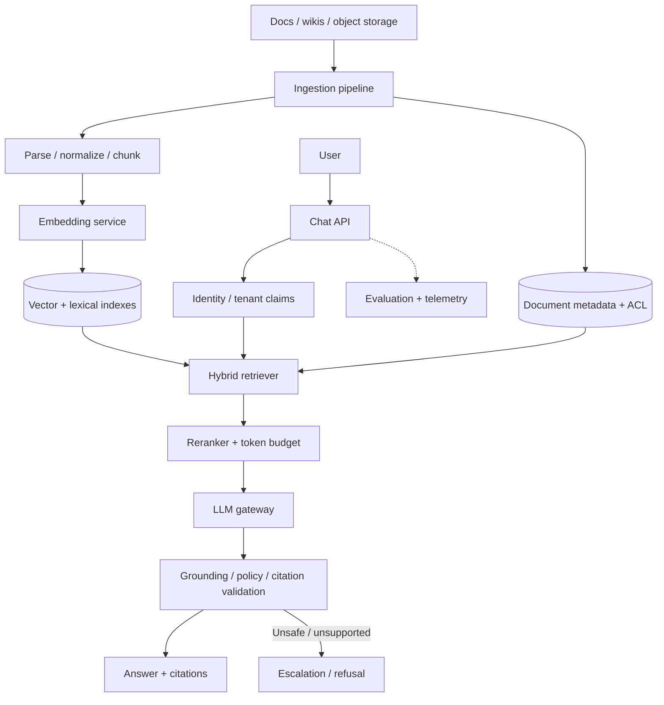
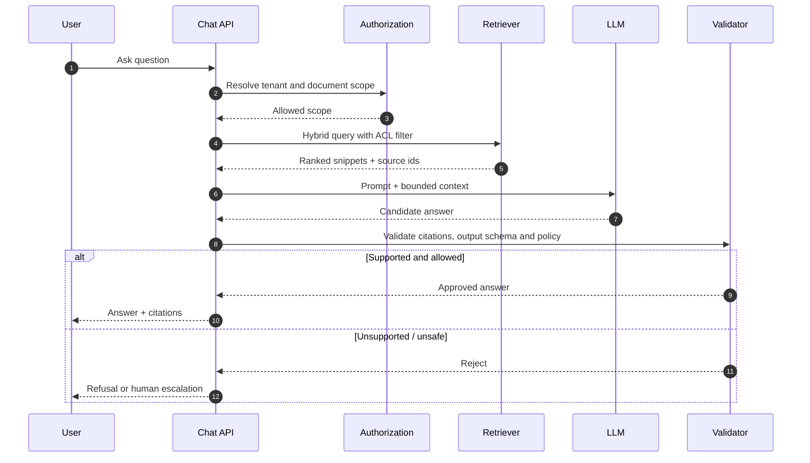

# RAG Knowledge Assistant — HLD Case Study

Build an assistant that answers questions from a private enterprise corpus with citations and document-level access controls.

## Architecture

## Retrieval sequence

## Critical invariants

- Tenant/document ACL is enforced by trusted backend logic, never inferred by the model.
- Deleted or permission-changed documents are removed from retrieval promptly.
- Retrieved text is untrusted input; prompt injection cannot authorize tools.
- Answers cite retrieved source ids; unsupported answers abstain or escalate.
- Embedding/index versions are tracked so reindex/rebuild can complete safely.

## Evaluation and operations

Measure retrieval recall@k, citation correctness, faithfulness, answer relevance, refusal correctness, latency, tokens/request, cost/task and ACL violation rate. Maintain a versioned golden set and human review. A single LLM-as-judge score is not a complete quality gate.

## Failure modes

| Failure | Mitigation |
|---|---|
| Low retrieval recall | Hybrid retrieval, query rewrite, rerank and recall evaluation |
| Stale index | Versioned events, tombstones and deletion propagation |
| Cross-tenant leakage | Authorization filter before prompt context |
| Prompt injection | Treat retrieved text as untrusted; tool policy remains independent |
| Hallucinated citation | Citation-to-span validation and abstention |
| Provider outage | Bounded retries, fallback and clear degraded mode |
| Token explosion | Context cap, dedupe, summarization and tenant budget |