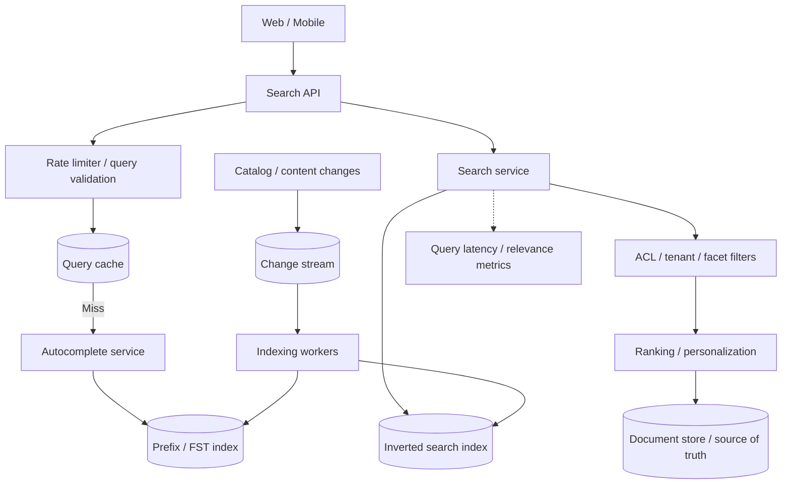
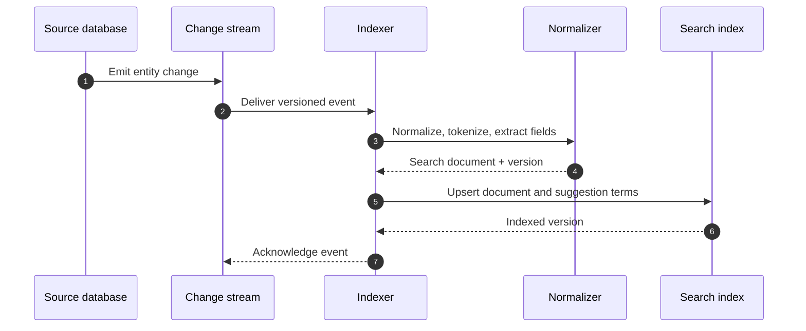
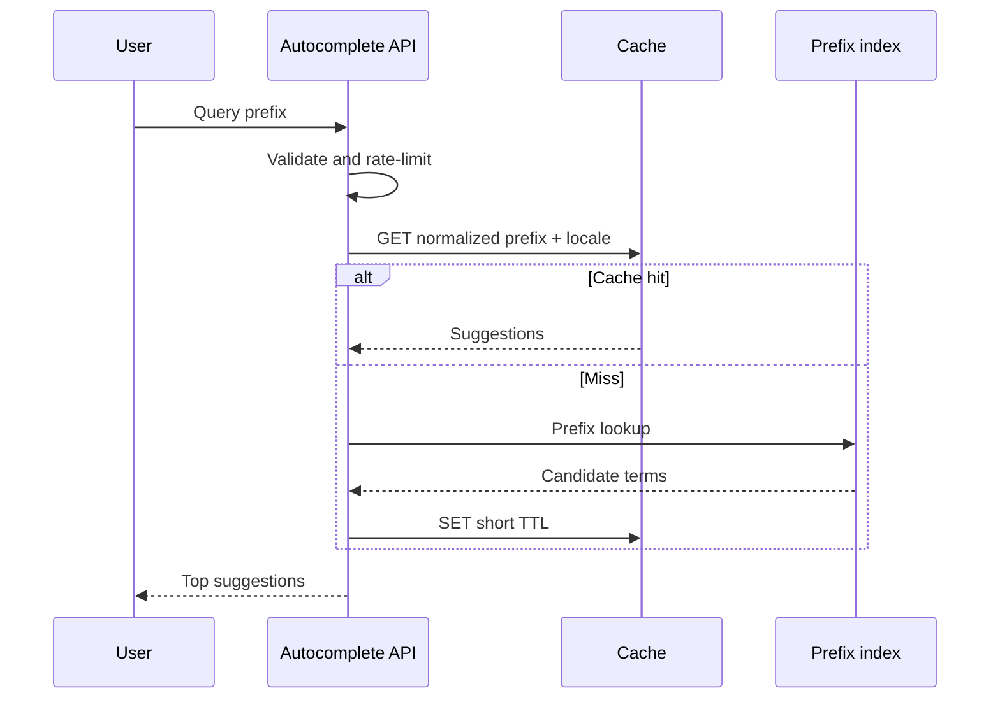

# Search and Autocomplete — HLD Case Study

Design typeahead suggestions and full-text search for a large catalog or content corpus.

## Requirements

- Prefix suggestions, typo tolerance, ranking and filtering.
- Full-text search with pagination and facets.
- Index freshness and deletion propagation.
- Low keystroke-to-suggestion latency, high availability and abuse protection.

Clarify languages, corpus size, update frequency, personalization, query privacy and relevance goals.

## Architecture

## Indexing sequence

## Typeahead sequence

## Trade-offs and failure modes

- Trie/FST for prefix lookup; inverted index for full-text relevance.
- Cache normalized prefix + locale + tenant + filters.
- Debounce client input, bound prefix length and rate-limit per user/IP.
- Indexing is asynchronous; expose indexing lag and version checkpoints.
- Tombstones/deletion events must remove stale suggestions/results.
- Apply authorization and tenant filters before returning documents.
- Track zero-result rate, click-through, abandonment, p95/p99 and freshness.