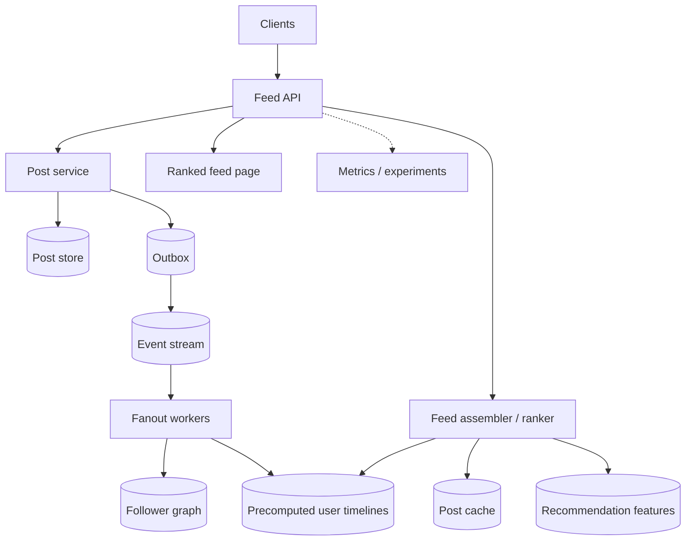
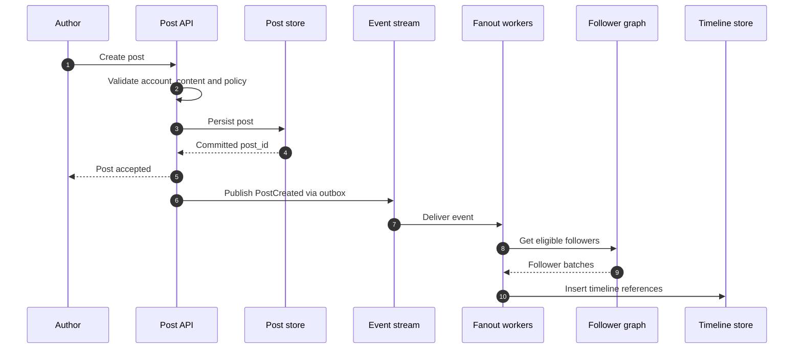
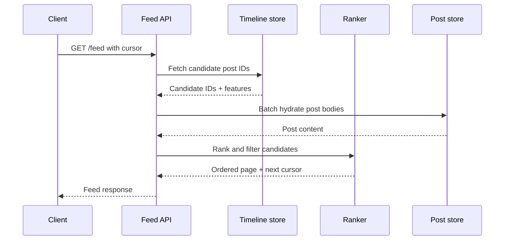

# Social Feed / Timeline — HLD Case Study

Design a personalized feed with post creation, follower graph, ranking, pagination and freshness. The central choice is fanout-on-write, fanout-on-read or a hybrid.

## Requirements and workload questions

Clarify read/write ratio, follower distribution, celebrity accounts, feed freshness, ranking personalization, deletion guarantees and pagination semantics. Peak traffic and growth are assumptions until measured.

## Architecture

## Create-post sequence

## Feed read sequence

## Fanout strategies

| Strategy | Strength | Weakness |
|---|---|---|
| Fanout-on-write | Fast feed reads | Write amplification for high-follower accounts |
| Fanout-on-read | Cheap post creation | Expensive read-time graph merge |
| Hybrid | Isolates celebrity/hot users | More complex read assembly and caching |

## Key decisions

- Store post content once; timeline rows usually store references.
- Use stable cursor pagination, not offset pagination at high volume.
- Apply block/privacy/deletion filters during candidate generation and final response.
- Make fanout idempotent with a unique (user_id, post_id) key.
- Re-rank a bounded candidate pool; do not scan the entire graph per request.
- Monitor feed freshness, fanout lag, cache hit rate and ranking latency.