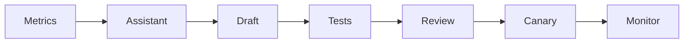

# AI / FDE Implementation

Use AI to summarize rollout metrics and draft targeting rules. Keep publishing behind schema validation, owner approval, audit and rollback.

Flags are not authorization. Evaluate exposure correctness, guardrail metrics and unintended cohort impact.
