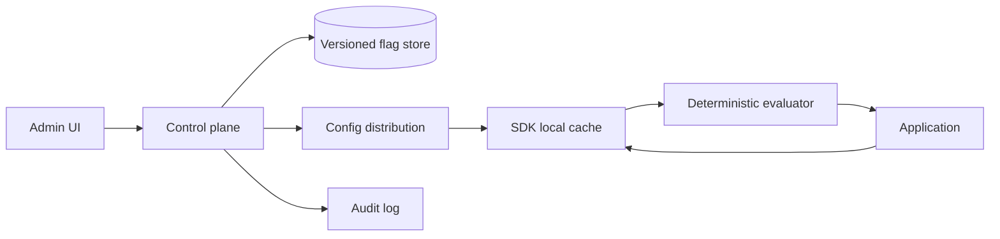
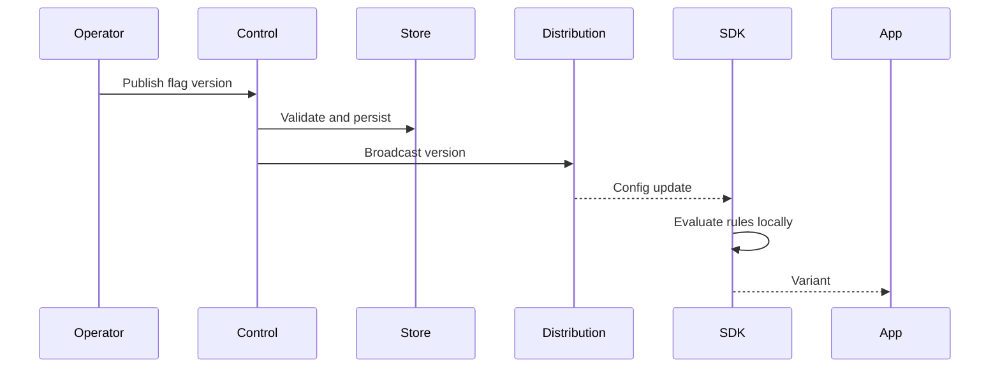

# Architecture

SDK evaluation should remain local and deterministic; define bounded stale-config behavior and safe defaults.

## Visual explainer

See [the enhanced visual architecture, critical sequence, failure/recovery flow, AWS/GCP starter mapping and interview walkthrough](visual_explainer.md). Editable Archify source: [archify/feature-flag-system.architecture.json](archify/feature-flag-system.architecture.json).
