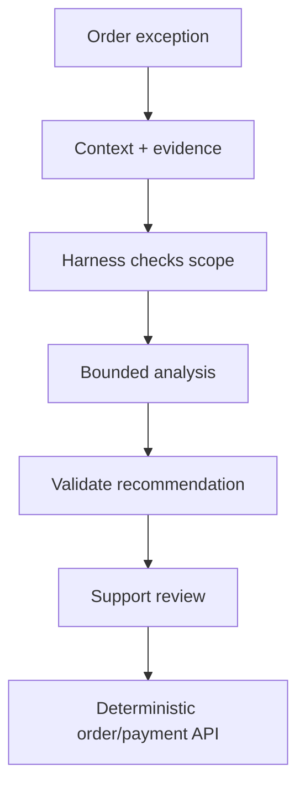

# AI / FDE Implementation — Food Delivery

AI supports menu semantic search, support-agent summaries and ETA explanations. Order, payment, refund and courier assignment remain deterministic.

Prompt defines task and schema; Context includes authorized order/menu/trip evidence; Harness scopes tools and verifies policy; Loop is bounded; Graph handles exception queues and human review.

Model output cannot independently charge, refund, cancel or reassign. Treat user messages and provider payloads as untrusted; verify webhooks separately.
