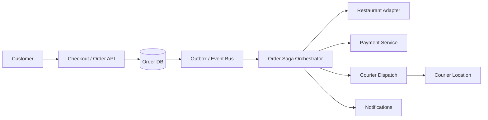
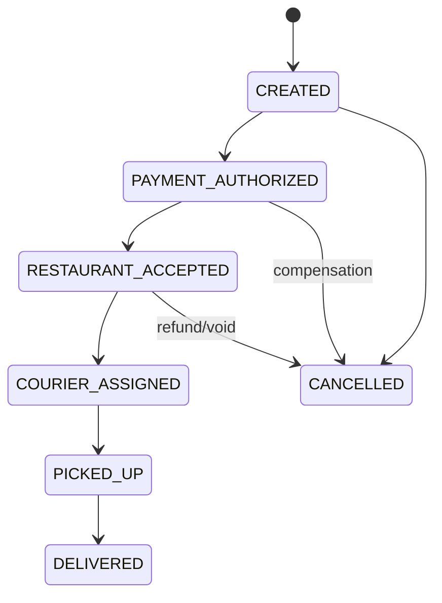

# Food Delivery Marketplace

## Scope
Restaurant discovery/menu, cart/checkout, order orchestration, payment, restaurant acceptance, courier dispatch, tracking, delivery and refunds.

## Architecture

## Critical flow
Checkout snapshots menu/price → create order + saga → authorize payment → restaurant accepts → assign courier → pickup → delivery → capture/settle. Each external step is idempotent and has timeout/compensation (void/refund, cancel, re-dispatch).

## Data model
Customer, Restaurant, MenuItem, Cart, Order, OrderLine(menu/price snapshot), Payment, Courier, Delivery, Refund, SagaStep. Order state is canonical; provider events are deduped by event ID.

## Failure modes
Menu price changed, restaurant timeout/rejection, payment webhook duplicate, courier unavailable, cancellation race, partial refund and stale GPS. Use quote expiry, saga compensation, reconciliation, bounded re-dispatch and explicit pending states.

## Trade-offs
Capture timing vs cancellation risk; batching courier routes vs ETA; centralized saga vs choreography; delivery fee/surge freshness vs quote stability.

## Interview walkthrough
Clarify geography, order volume, restaurant/courier lifecycle, payment guarantees and ETA. Estimate order QPS and location updates. Explain order saga, menu snapshot, idempotent webhooks, courier matching, cancellation and refund reconciliation.

## Visual explainer

## AI/FDE
AI can help menu search, support summaries and ETA explanations. Prompt defines task; Context uses order/restaurant facts within authorization; Harness gates tools; Loop is bounded; Graph coordinates exception handling and human support. Do not allow model to charge/refund or change order state without deterministic policy and approval.
