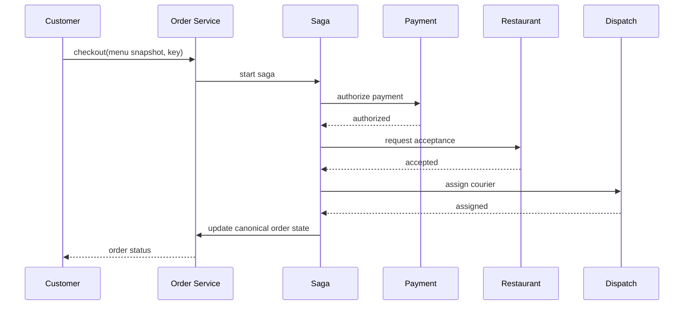

# Architecture — Food Delivery

Order service owns state and writes an outbox event. Saga orchestrator coordinates payment authorization, restaurant acceptance, courier assignment and settlement. Each adapter uses idempotency keys and signed webhook verification. Location and ETA are separate streaming projections.

Scale menu reads with cache/versioning; partition orders by region/orderId; use event-driven status updates and reconciliation jobs for provider drift.
