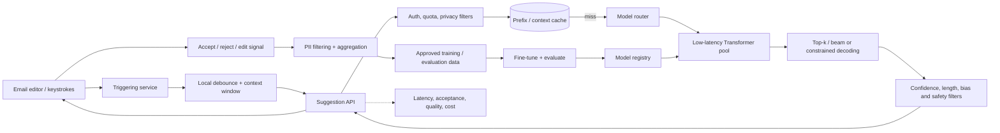
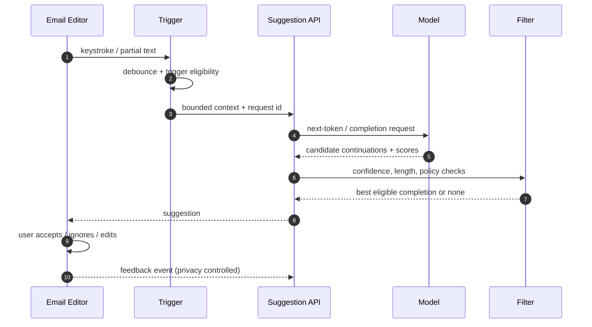

# Gmail Smart Compose — GenAI System Design

> Interview-style case study inspired by the publicly described Smart Compose problem. This is an original system design; it does not claim to reproduce Google's internal production architecture.

## 1. Requirements and assumptions

- Suggest a short continuation while a user composes an email; user explicitly accepts or ignores it.
- Suggestions should feel near-instant (target around 100 ms for the interactive path).
- Start with English and current message body; personalization and broader context are extensions.
- High confidence only; avoid biased or inappropriate suggestions.
- Large-scale serving with privacy-preserving training data handling.

## 2. ML task
Input: partial email text and optional authorized context. Output: candidate next tokens/phrase plus confidence. A decoder-only Transformer is a reasonable baseline for next-token generation. Use constrained short completions rather than open-ended long responses.

## 3. Architecture

## 4. Request sequence

## 5. Data and model
- Data: general text plus approved email corpora; remove or mask personal names, addresses, phone numbers, URLs and secrets where appropriate.
- Tokenization: subword tokenizer (BPE/SentencePiece family); version tokenizer with model.
- Training: next-token objective; fine-tune on email style and short continuations.
- Context: start with body prefix; later include subject/recipient/thread context only with clear privacy and product consent.
- Decoding: short beam/top-k candidates; stop at punctuation/EOS; suppress long or low-confidence completions.
- Postprocessing: neutrality and sensitive-language filters; do not rewrite user intent.

## 6. API and client behavior
- `POST /v1/suggestions`: prefix, locale, optional context metadata, request ID → candidate text, confidence band, expiry.
- Client debounces keystrokes, cancels stale requests and only displays results matching the current editor revision.
- No suggestion is a valid response; avoid forcing generation when confidence is low.
- Do not persist raw email text by default; operational logs use redacted metadata.

## 7. Latency and scale
- Trigger only after enough context and on meaningful pause; debounce/cancel to avoid waste.
- Keep small model pools warm in each region; batch compatible requests with a strict max-wait budget.
- Cache only privacy-safe, scoped prefixes; email text is highly sensitive, so default to no shared raw-prefix cache.
- Use quantization/speculative decoding where measured quality remains acceptable.
- Route to larger model only for supported contexts; strict latency budget favors a small model.
- Monitor p50/p95/p99 end-to-end latency, stale-response rate, GPU utilization and cost per accepted suggestion.

## 8. Evaluation
- Offline: perplexity, exact-match@k, human quality, grammaticality, relevance, bias and privacy leakage tests.
- Online: acceptance rate, edit distance after acceptance, time saved, ignore rate, latency and complaint rate.
- Slice by language, writing style, recipient context and demographic fairness tests.
- Guard against feedback loops: accepted suggestions are not automatically treated as ground-truth without filtering.

## 9. Failure modes
| Failure | Mitigation |
|---|---|
| Suggestion arrives late | cancellation, client revision check, deadline |
| Low-confidence completion | return no suggestion |
| Sensitive data exposure | redaction, strict retention, tenant isolation |
| Biased phrase | policy filters, slice evaluation, feedback review |
| Model outage | graceful no-suggestion behavior |
| Feedback loop degradation | sampled human review and versioned eval |

## 10. Interview extensions
- Personalization without leaking between users.
- Multilingual suggestions and language detection.
- Subject/recipient/thread context and privacy trade-offs.
- On-device model for sensitive contexts.
- Speculative decoding and model distillation for latency.

## References
- [ByteByteGo — Gmail Smart Compose](https://bytebytego.com/courses/genai-system-design-interview/gmail-smart-compose)
- [Gmail Smart Compose: Real-Time Assisted Writing](https://arxiv.org/abs/1906.00080)
- [Attention Is All You Need](https://arxiv.org/abs/1706.03762)

Original architecture and diagrams; ByteByteGo is cited as further reading.