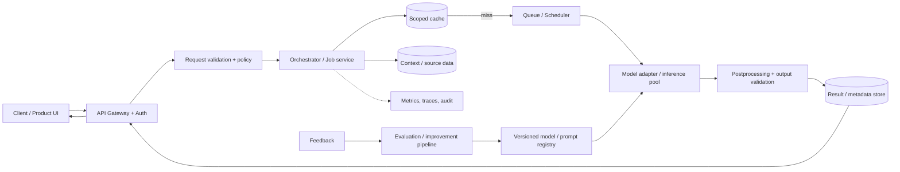
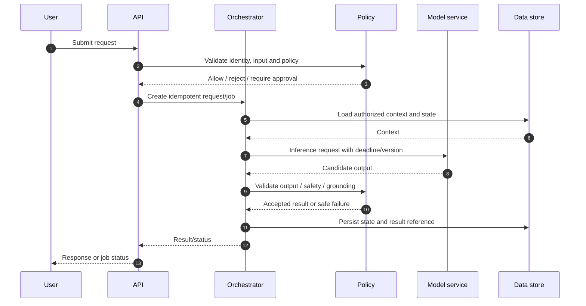

# Architecture — Gmail Smart Compose

## Scope
Low-latency email continuation; contextual completion with privacy-sensitive user text.

## Logical architecture

## Online request sequence

## Deployment boundaries
- Stateless API/orchestrator replicas behind a load balancer.
- Durable database separated from cache and queue.
- Model workers scale on queue age, GPU/CPU utilization and request class.
- Private object storage for media; short-lived signed URLs for authorized access.
- Separate offline ingestion/training/evaluation from online serving.

## SLOs and observability
Track availability, p50/p95/p99 latency, queue age, model error rate, quality/evaluation scores, policy outcomes, cost per successful request and data freshness. Establish numeric targets after workload and product requirements are agreed.