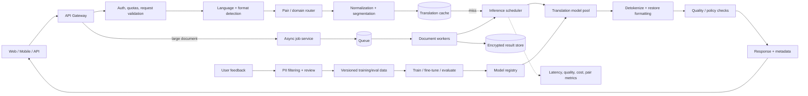
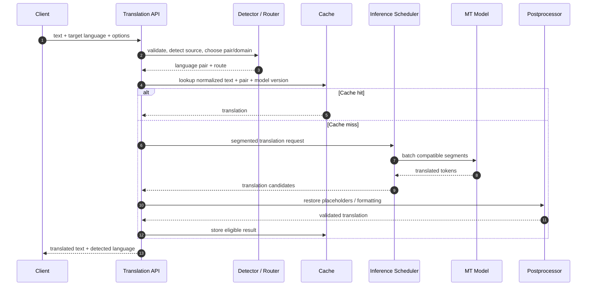

# Google Translate — GenAI System Design

> Original interview-oriented design. This is a conceptual architecture, not a claim about Google's internal implementation.

## 1. Problem and scope

Translate text (and optionally speech) between supported languages while preserving meaning, tone and formatting. Start with text translation; add document, speech and multimodal paths as extensions.

### Requirements
- Detect source language when unspecified; accept explicit source/target language.
- Return translation with low latency for common language pairs; support longer documents asynchronously.
- Preserve paragraph boundaries, placeholders, names, numbers and markup.
- Support quality improvements from approved feedback and evaluation data.
- Protect submitted text; enforce retention and deletion policy.

**Quality / SLO dimensions:** translation quality by language pair/domain, p95 latency, availability, throughput, cost per translated character, formatting preservation, harmful-content handling.

## 2. High-level architecture

## 3. Request sequence

## 4. Data and model design
- **Inputs:** source text, language pair, domain/style hints, format metadata, optional glossary.
- **Preprocessing:** Unicode normalization, sentence segmentation, placeholder protection for URLs/numbers/entities; avoid destructive normalization.
- **Model:** encoder-decoder Transformer is a natural baseline for conditional translation. Use language tags and multilingual shared models where data supports it; specialized pair/domain models may improve quality.
- **Decoding:** beam search or constrained decoding for stable translation; latency-sensitive paths can use smaller models or optimized decoding.
- **Training:** parallel corpora, approved human translations, synthetic back-translation with quality filters, domain-specific fine-tuning. Maintain language-pair and domain balance.
- **Serving:** model registry, canary versions, pair-aware routing, GPU batching, quantization where quality remains acceptable.

## 5. Interfaces and storage
- `POST /v1/translate`: `{text, sourceLanguage?, targetLanguage, format?, glossaryId?}` → `{translation, detectedSourceLanguage, modelVersion}`.
- `POST /v1/document-jobs`: returns job ID for large files; `GET /v1/document-jobs/{id}` returns status/result.
- Cache key includes normalized input, source/target pair, glossary/version, domain, model version and relevant options.
- Store only what product policy requires; separate operational metadata from text payload; encrypt at rest and in transit.

## 6. Scaling and reliability
- Route by language pair and model capability; keep warm capacity for common pairs.
- Batch by compatible model, pair and sequence-length bucket; cap batching delay to preserve latency.
- Use token/character quotas, admission control and queue-based async document jobs.
- Cache common short phrases only when privacy and freshness rules permit.
- Fallback to a supported general model or return an explicit partial/temporary failure; never silently label source text as translated.
- Circuit-break unhealthy model pools; retry only idempotent inference requests with bounded deadlines.

## 7. Evaluation
- Offline: BLEU/chrF/COMET-style metrics plus bilingual human review, terminology and formatting tests.
- Slice by language pair, direction, domain, length, dialect and rare-language coverage.
- Online: latency, completion rate, user edits/copy behavior, feedback, glossary adherence and cost.
- Regression gate: safety, entity/number preservation, language-pair quality floor and human-reviewed samples.

## 8. Risks and trade-offs
| Risk | Mitigation |
|---|---|
| Low-resource pair quality | Pair-specific data strategy, human evaluation, abstain/label uncertainty |
| Hallucinated additions/omissions | Adequacy checks, segment alignment, human feedback |
| Names/numbers corrupted | Protected spans and round-trip tests |
| Cache leaks sensitive text | Tenant/privacy-aware cache policy, short TTL or disable |
| Model update regresses one pair | Pair-sliced canary and rollback |
| Adversarial text / unsafe content | Input/output policy, abuse limits, safe handling without changing meaning |

## 9. Interview extensions
1. Speech translation: streaming ASR → translation → TTS with chunk alignment.
2. Document translation: preserve layout, glossary, job status and resumability.
3. Personalization: user glossary/style profile with explicit controls and privacy boundary.
4. Low-resource languages: transfer learning, synthetic data, human-in-the-loop quality.
5. Multimodal translation: OCR / image context with provenance and uncertainty.

## 10. Portfolio implementation
Build a text-only MVP: FastAPI/Node API, language detection, hosted or local encoder-decoder model, Redis cache, async document queue, evaluation set, pair-level dashboard and model-version rollout.

## References
- [ByteByteGo — GenAI System Design Interview](https://bytebytego.com/courses/genai-system-design-interview/introduction-and-overview)
- [Attention Is All You Need](https://arxiv.org/abs/1706.03762)
- [BLEU](https://aclanthology.org/P02-1040/)
- [COMET](https://aclanthology.org/2020.emnlp-main.213/)

Original design and diagrams; course material is further reading, not reproduced.