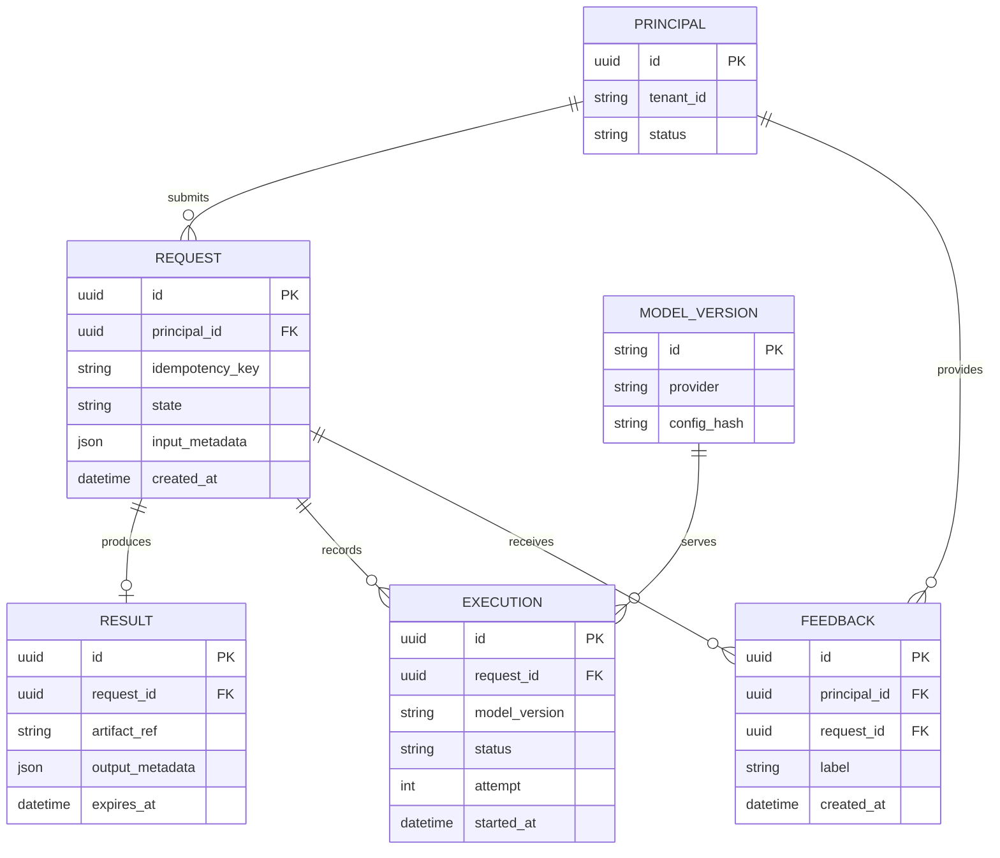
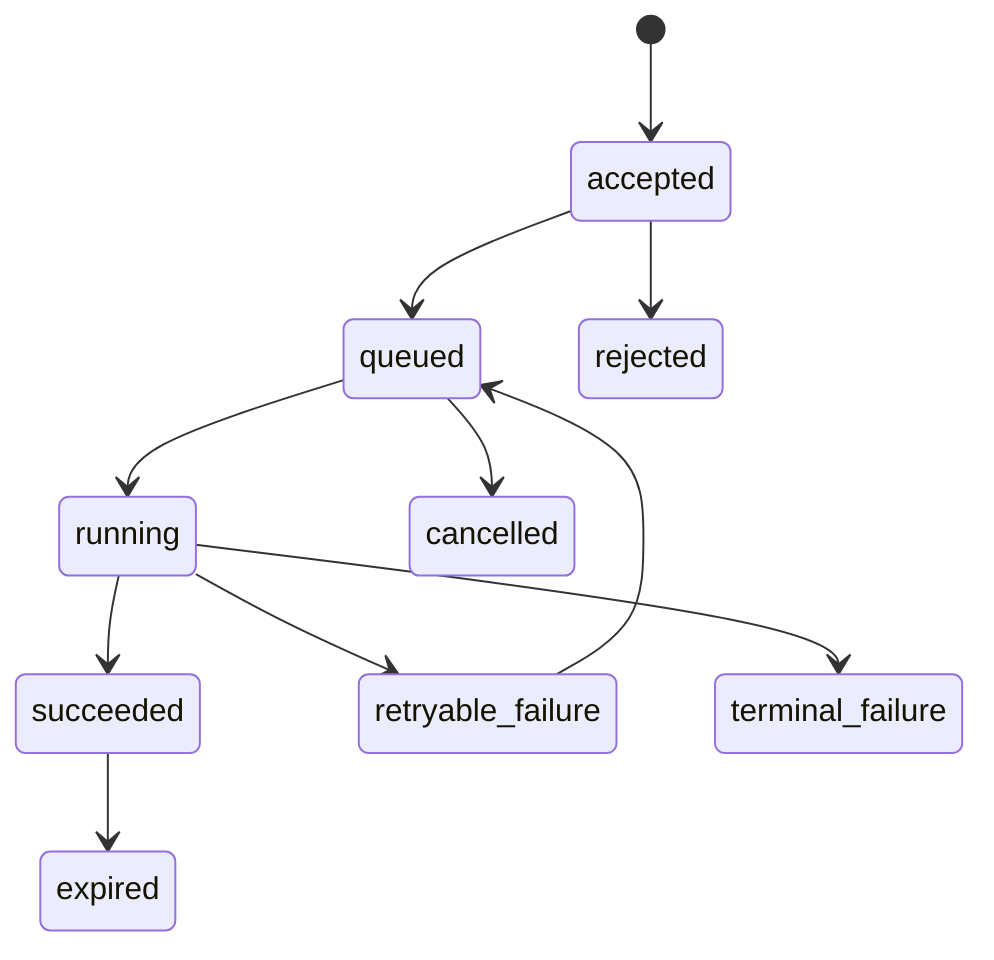

# Data Model — Google Translate

## Design goals
Support multilingual text translation with language-pair routing, quality evaluation and optional async document jobs. with tenant/user boundaries, versioning, traceability, idempotency and retention/deletion.

## Core entities

## Storage notes
- Keep large text/media payloads in encrypted object storage when appropriate; relational DB stores metadata and references.
- Add indexes on tenant/principal, state, created_at and idempotency key.
- Unique constraint: (tenant_id, idempotency_key) for request creation.
- Store model/prompt/config versions to reproduce evaluation and investigate regressions.
- Avoid logging raw sensitive inputs by default; define retention and deletion propagation across cache, indexes, artifacts and backups.

## State lifecycle

Adapt entities and fields to the product-specific requirements; do not persist model internals that are not needed for audit or reproducibility.