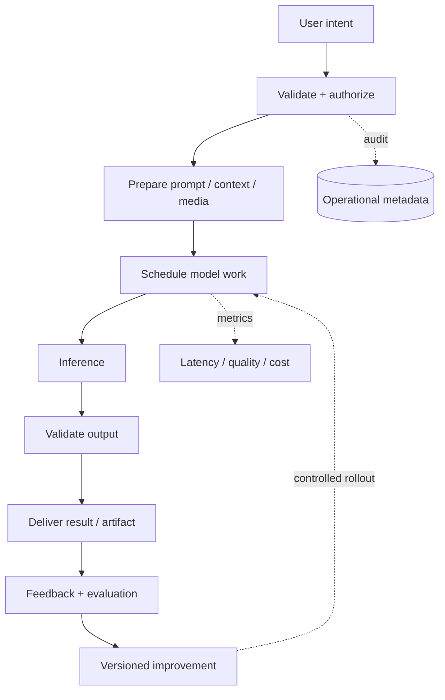

# Visual Explainer — Google Translate

## One-minute mental model
Multilingual text translation with language-pair routing, quality evaluation and optional async document jobs. The product is a control plane around a model: validate and authorize inputs, prepare context, schedule inference, validate outputs, persist results and measure quality/cost.

## Architecture at a glance

## Data plane vs control plane
- **Data plane:** request payload, context, inference, generated result and delivery.
- **Control plane:** auth/policy, quotas, routing, model versions, job state, evaluation, rollout and audit.

## Explain the key boundary
Keep model output untrusted until schema, policy, grounding/quality and authorization checks pass. Keep expensive or long-running work behind a durable job boundary. Keep sensitive payloads out of general logs.

## Draw-this-in-interview checklist
- Label synchronous and asynchronous arrows.
- Mark database, cache, queue and object storage separately.
- Show trust/tenant boundaries and model version.
- Add failure/retry path and observability.
- Identify the bottleneck and scaling lever.