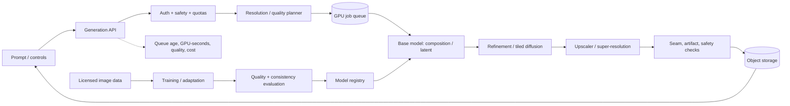
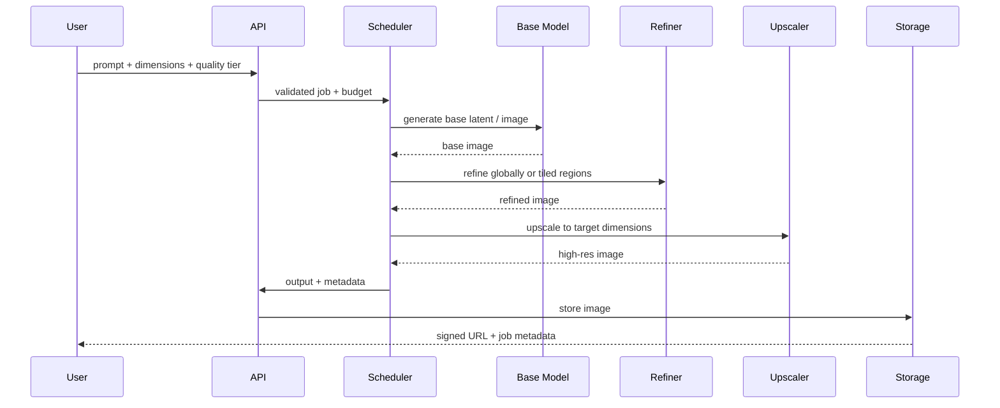

# High-Resolution Image Synthesis — GenAI System Design

## 1. Problem

Generate high-resolution images while managing memory, inference time, coherence and cost. A practical design uses a staged pipeline: composition at lower resolution, then latent or pixel-space refinement/upscaling.

## 2. Architecture

## 3. Job sequence

## 4. Model and pipeline choices
- Base generation: latent diffusion or cascaded diffusion.
- High-resolution strategies: latent upscaling, tiled diffusion with overlap/blending, patch-based refinement, super-resolution models.
- Preserve global composition by conditioning refiners on the base image and prompt; use overlapping tiles to reduce seams.
- Track seed, model versions, sampler, step count, guidance, dimensions and upscaler version.
- Training data requires licenses, deduplication and quality filtering.

## 5. API / data
- `POST /v1/image-jobs`: prompt, width/height, quality tier, optional seed.
- `GET /v1/image-jobs/{id}`: queued/running/failed/completed.
- Job record includes estimated/actual GPU budget, stage status, model versions, output refs and safety decisions.
- Store intermediate artifacts with short TTL; retain only final output unless debugging is opted in.

## 6. Scaling
- Schedule by estimated GPU memory and compute, not just job count.
- Separate base-generation and upscale queues; allocate GPU pools by stage.
- Dynamic batch low-resolution compatible jobs; high-res jobs may require exclusive GPU slots.
- Offer quality tiers and enforce pixel/step budgets.
- Use cancellation and checkpointing at stage boundaries; retries should reuse valid intermediate artifacts.

## 7. Evaluation
- Human preference and prompt adherence; FID/KID for distribution-level comparisons.
- Resolution-specific artifact checks: texture consistency, sharpness, seam detection, text/face distortions.
- Evaluate crops and global coherence, not only full-frame metrics.
- Monitor time-to-first-preview, completion time, failure rate and GPU cost per megapixel.

## 8. Risks
| Risk | Mitigation |
|---|---|
| Tile seams | overlap, blending, global conditioning, seam evaluator |
| Detail inconsistent with composition | staged conditioning and low-frequency consistency |
| VRAM OOM | planner, tiling, memory-aware queue, fallback tier |
| Excessive cost | pixel/step budgets, preview tier, async scheduling |
| Unsafe content | policy checks at prompt and output stages |
| Upscaler invents detail | make enhancement explicit; evaluate fidelity vs realism |

## 9. Interview extensions
- Interactive editing/inpainting with region masks.
- Video frame upscaling with temporal consistency.
- Multi-GPU distributed inference and model sharding.
- User-facing preview/quality trade-off.

## 10. Portfolio build
Create a staged pipeline with a base model adapter, tiled refiner, upscaler, job queue, artifact reuse and metrics for GPU-seconds/megapixel.

## References
- [ByteByteGo — GenAI System Design Interview](https://bytebytego.com/courses/genai-system-design-interview/introduction-and-overview)
- [High-Resolution Image Synthesis with Latent Diffusion Models](https://arxiv.org/abs/2112.10752)
- [Real-ESRGAN](https://arxiv.org/abs/2107.10833)

Original design and diagrams.