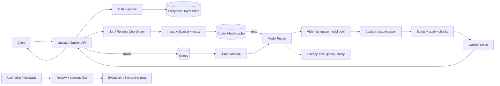
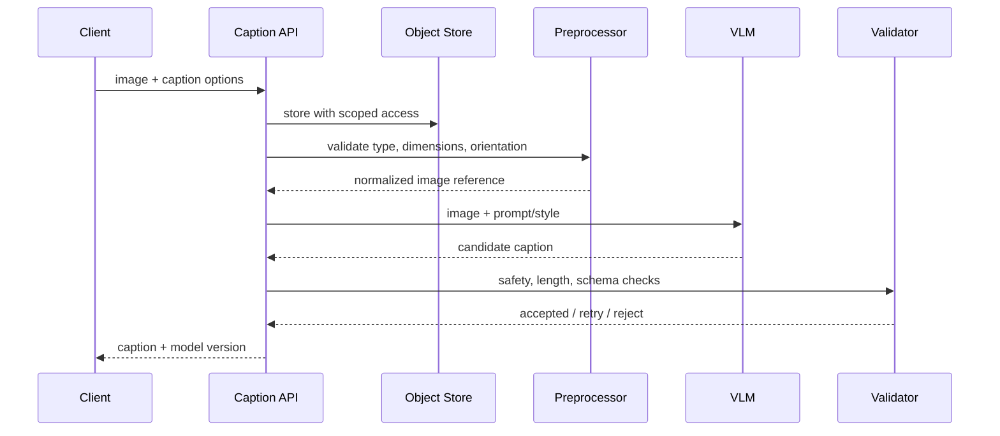

# Image Captioning — GenAI System Design

## 1. Problem framing

Generate a concise, useful caption for an image; optionally produce detailed descriptions or captions tailored to accessibility, search or moderation workflows.

**Inputs:** image bytes or object reference, language/style, detail level, optional context. **Outputs:** caption, confidence/quality signals, model version and optional detected entities.

Requirements: upload safety, bounded image dimensions, low latency for single images, async batch processing, privacy controls, robust behavior on ambiguous or sensitive imagery.

## 2. Architecture

## 3. Online sequence

## 4. Model and data
- Baseline: vision encoder + text decoder, or instruction-tuned vision-language model (VLM).
- Preprocessing: EXIF orientation, resize/crop policy, color normalization, file type and decompression-bomb checks.
- Training data: licensed image-caption pairs; deduplicate near-identical images; filter low-quality, unsafe and personally identifying content according to policy.
- Fine-tuning: caption style, domain vocabulary and accessibility needs; keep a held-out set by domain and demographic/sensitive slices.
- Do not infer identity or sensitive attributes as a default captioning behavior.

## 5. API and storage
- `POST /v1/captions` accepts upload/reference and options; returns caption synchronously for small images or job ID for larger workloads.
- `GET /v1/caption-jobs/{id}` for async status.
- Object store uses short-lived signed URLs; metadata DB stores owner, hash, dimensions, status, result reference and retention.
- Cache key includes image hash, prompt/style, model version and policy configuration; privacy-sensitive requests may bypass cache.

## 6. Scaling
- GPU inference workers with dynamic batching by image size/model.
- Separate real-time and batch queues; prioritize interactive traffic.
- Apply image-size caps, concurrency limits and per-tenant quotas.
- Use model cascade: small model for common requests, larger VLM for detailed or low-confidence cases.
- Keep preprocessing CPU-scaled and inference GPU-scaled; monitor queue age and GPU utilization.

## 7. Evaluation
- Offline: CIDEr, SPICE, BLEU/ROUGE as diagnostics, plus human ratings for factuality, relevance, coverage and hallucination.
- Evaluate object/action/relationship mentions, OCR content, image quality and accessibility usefulness.
- Online: edit distance from user corrections, acceptance, latency, cost/image, safety incidents.
- Use adversarial sets for unusual crops, low light, text-heavy images and ambiguous scenes.

## 8. Failure and safety
| Failure | Mitigation |
|---|---|
| Caption invents objects | grounding checks, conservative prompt, human review samples |
| Image malformed/huge | type sniffing, pixel cap, decoder sandbox |
| Sensitive content | policy classifier, limited description, safe refusal where required |
| Model outage | alternate model, async retry, explicit unavailable status |
| Duplicate uploads | content hash + scoped idempotency |
| Private image leaks via cache | tenant-aware cache and retention controls |

## 9. Interview extensions
- Batch captioning for photo libraries; event-driven ingestion and deletion.
- Multilingual captions; translate only after caption grounding.
- Search indexing: captions plus image embeddings, with ACL enforcement.
- Accessibility: concise alt text versus verbose scene description.

## 10. Portfolio build
Create an image upload service, object store, VLM adapter, job queue, evaluation harness and caption review dashboard. Add a benchmark set with human labels and explicit hallucination scoring.

## References
- [ByteByteGo — GenAI System Design Interview](https://bytebytego.com/courses/genai-system-design-interview/introduction-and-overview)
- [Show, Attend and Tell](https://arxiv.org/abs/1502.03044)
- [COCO Captions](https://cocodataset.org/#captions)

Original case study and diagrams.