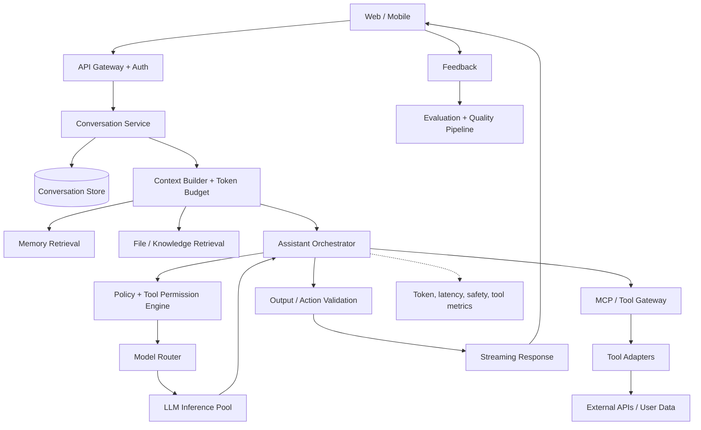
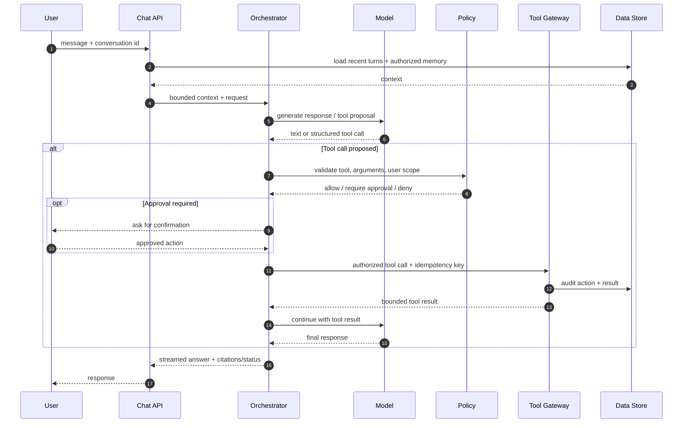

# ChatGPT: Personal Assistant Chatbot — GenAI System Design

> Original system-design case study for a conversational assistant with tools and optional memory.

## 1. Scope and requirements

A multi-turn assistant answers questions, uses tools when useful, and optionally remembers user-approved context. Distinguish **chat response generation** from **agentic actions**.

- Functional: streaming conversation, conversation history, tool calling, file/context retrieval, optional memory, user feedback, cancel/continue.
- Non-functional: low first-token latency, durable conversation state, tenant isolation, graceful provider fallback, auditable side effects.
- Safety: prompt-injection defenses, tool authorization, confirmation for consequential writes, privacy/deletion controls.

## 2. Architecture

## 3. Turn sequence (tool loop)

## 4. Core data model
- `Conversation(id, tenantId, ownerId, createdAt, retentionPolicy)`
- `Message(id, conversationId, role, contentRef, tokenCount, createdAt, safetyLabels)`
- `ToolExecution(id, conversationId, toolName, argsHash, status, idempotencyKey, approvalId, auditRef)`
- `Memory(id, ownerId, type, contentRef, sourceMessageId, consent, expiresAt, version)`
- Store large files separately; persist message ordering with sequence numbers. Encrypt sensitive content and support deletion propagation.

## 5. API sketch
- `POST /v1/conversations`
- `POST /v1/conversations/{id}/turns` (SSE/WebSocket stream)
- `POST /v1/tool-executions/{id}/approve`
- `GET /v1/conversations/{id}/messages?cursor=...`
- `DELETE /v1/conversations/{id}` (tombstone, async purge, index/cache cleanup)

## 6. Context and memory
- Keep a sliding recent-turn window plus summaries; enforce token budgets by priority.
- Retrieve memory only when relevant and authorized; show provenance and allow user review/delete.
- Treat retrieved files, web pages and tool outputs as untrusted data—not instructions.
- Cache only with user/tenant/model/prompt version in key; avoid cross-user semantic cache leakage.

## 7. Scaling and reliability
- Stateless API/orchestrator workers; durable conversation store and event log.
- Separate interactive inference from long-running agent jobs; queue background tasks.
- Model routing by capability, context length, latency and cost; fallback only when semantics permit.
- Tool gateway applies per-tool quotas, deadlines, retries and idempotency. Retry reads safely; writes require idempotency and reconciliation.
- Stream partial output, support cancellation, cap concurrent turns per conversation, and use backpressure for slow clients.

## 8. Safety and evaluation
- Separate model suggestions from authorization decisions.
- Prompt-injection defense: untrusted content labels, tool allowlists, argument validation, least privilege, output checks.
- Redact secrets/PII where required; avoid storing chain-of-thought; retain concise audit rationale and tool outcomes.
- Offline: task completion, answer correctness, citation accuracy, tool-call precision, refusal/approval behavior.
- Online: user satisfaction, abandonment, tool success, latency, cost/turn, unsafe action rate, escalation rate.

## 9. Failure modes
| Failure | Design response |
|---|---|
| Model/provider unavailable | fallback model, graceful retry, preserve conversation |
| Tool timeout | bounded retry, status tracking, partial answer or resume |
| Duplicate write | idempotency key, action ledger, reconciliation |
| Context exceeds limit | summarize, retrieve selectively, explain omitted context |
| Prompt injection | policy boundary outside model; deny unauthorized tools |
| Memory stale/wrong | provenance, expiry, user controls, confidence threshold |
| Streaming disconnect | turn ID, resumable status, persist generated chunks selectively |

## 10. Interview extensions
- Multi-agent delegation: isolate roles, shared task ledger, bounded budgets.
- Voice: streaming ASR/TTS, turn detection, interruption and latency budget.
- Enterprise: tenant ACL retrieval, audit, retention and admin controls.
- Personalization: explicit opt-in memory and preference update flow.

## 11. Portfolio build
Implement a chat API with streaming, Postgres conversation store, Redis rate limits, model adapter, MCP tool gateway, approval workflow, action ledger, eval dataset and tracing.

## References
- [ByteByteGo — GenAI System Design Interview](https://bytebytego.com/courses/genai-system-design-interview/introduction-and-overview)
- [MCP specification](https://modelcontextprotocol.io/)
- [OWASP Top 10 for LLM Applications](https://owasp.org/www-project-top-10-for-large-language-model-applications/)

Original design; not a reproduction of proprietary course diagrams.