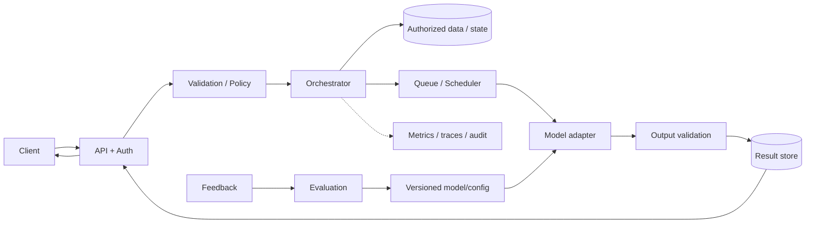
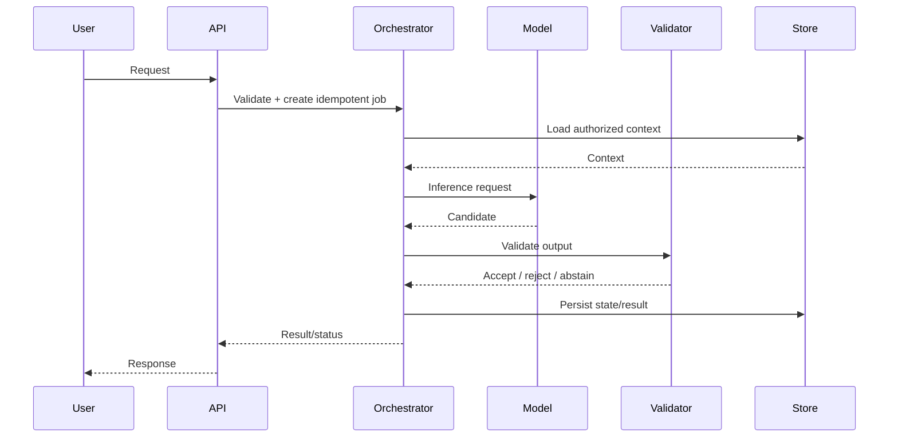
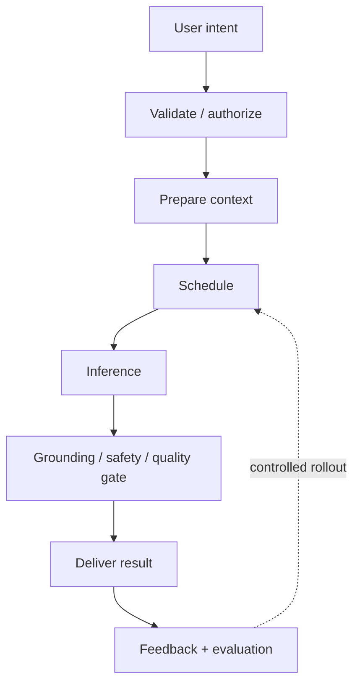

# visual explainer — ChatGPT Personal Assistant

## Context
Multi-turn assistant with authorized retrieval, MCP tools, approval and optional memory.

## Design
- Model/task: LLM with tool-call outputs.
- Main flow: context assembly → tool proposal → authorization → tool execution → answer.
- Scale/reliability: durable conversation store, stateless orchestrator, idempotent tool gateway.
- Evaluation: task success, citation accuracy, tool precision, unsafe-action rate.

## Architecture

## Request sequence

## Data/API notes
Use typed request/job/result contracts; persist tenant/user scope, idempotency key, status, model/config version, timestamps and artifact references. Large media goes to encrypted object storage; metadata in relational storage. Enforce ACLs server-side and define retention/deletion.

## Operational requirements
Set separate interactive p95 and async completion SLOs. Track queue age, model errors, quality, safety outcomes, cost/success and data freshness. Use deadlines, cancellation, bounded retries, DLQ/redrive and versioned rollback.

## Risks and trade-offs
| Risk/choice | Mitigation / rationale |
|---|---|
| Model outage | bounded retry, compatible fallback, graceful unavailable state |
| Duplicate requests | idempotency key and execution ledger |
| Low-quality output | validator, bounded regeneration, abstention/human review |
| Privacy/ACL leak | tenant scoping, least privilege, redacted logs, purge verification |
| Sync vs async | sync only for bounded work; durable queue for expensive tasks |
| Quality vs cost | model tiers and measured evaluation gates |

## Implementation / interview prompts
Build a typed API, provider-independent adapter plus stub, persistence/state machine, policy checks, evaluation fixtures and tracing. Explain workload assumptions, first bottleneck, recovery, rollout gate and scale evolution in an interview.

## Visual summary

## References
- [ByteByteGo GenAI system design overview](https://bytebytego.com/courses/genai-system-design-interview/introduction-and-overview)
- [MCP specification](https://modelcontextprotocol.io/)

Content and diagrams are original study material.