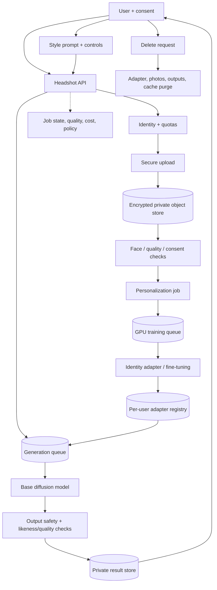
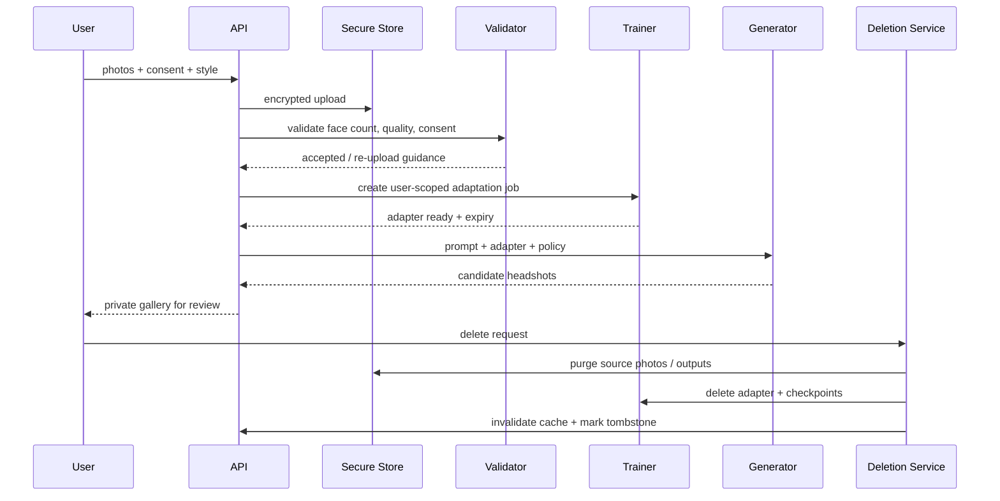

# Personalized Headshot Generation — GenAI System Design

## 1. Scope and privacy

Generate professional headshots based on photos supplied by the consenting user. Design around explicit consent, private training/inference, likeness protection and deletion. No third-party likeness generation without authorization.

Requirements: upload a set of user photos, validate quality/consent, adapt a model to the user's identity, generate requested styles, review outputs, delete source/adaptation artifacts.

## 2. Architecture

## 3. Sequence

## 4. Model and data
- Base: diffusion model with identity adapter (e.g., LoRA/DreamBooth-style adaptation) and optional face-consistency conditioning.
- User photos must be user-provided with consent; validate that uploads depict one consenting subject and are adequate quality.
- Avoid training on unrelated photos; isolate per-user adapters and access controls.
- Prompt controls: wardrobe, background, lighting, crop and style; protect identity while avoiding exaggerated transformations.
- Record base model, adapter version, training parameters and retention expiry.

## 5. API and lifecycle
- `POST /v1/headshot-sessions` creates a session and consent record.
- `POST /v1/headshot-sessions/{id}/photos` uploads images.
- `POST /v1/headshot-sessions/{id}/train` queues adaptation.
- `POST /v1/headshot-sessions/{id}/generations` requests styles.
- `DELETE /v1/headshot-sessions/{id}` triggers verified purge.
- State machine: `created → uploaded → validating → training → ready → generating → completed`; terminal states include `rejected`, `failed`, `expired`, `deleting`, `deleted`.

## 6. Scaling and reliability
- Separate adaptation and generation queues; training is heavier and longer-lived.
- GPU scheduler tracks memory, image count, steps and adapter residency.
- Reuse adapter only within the user's session and retention window; avoid cross-user adapter cache.
- TTL-based session expiry and explicit deletion job with retries and audit.
- Persist checkpoints only when needed for resumability; purge intermediate checkpoints after completion.
- Idempotent job creation and deletion; deletion status visible to user.

## 7. Evaluation and safety
- Identity consistency, photorealism, prompt adherence, diversity and user preference.
- Evaluate false identity drift, demographic performance gaps and artifact rates.
- Verify consent and limit generation volume; prevent impersonation and non-consensual use.
- Encrypt photos/adapters/results; short-lived signed URLs; restrict support access and audit it.
- Deletion tests cover object storage, adapters, checkpoints, caches, logs and backups according to retention policy.

## 8. Risks
| Risk | Mitigation |
|---|---|
| Non-consensual likeness | consent UX, user ownership checks, abuse reporting |
| Identity drift | face-consistency evaluation, controlled prompts |
| Sensitive photo exposure | encryption, tenant isolation, short-lived URLs |
| Deletion incomplete | purge orchestration, tombstones, reconciliation |
| GPU cost spikes | image/step quotas, package tiers, queue budget |
| Unsafe output | prompt/output policy, human review escalation |

## 9. Interview extensions
- Multi-person group portraits (consent per subject).
- Enterprise headshots with brand templates and batch jobs.
- On-device adaptation and private model execution.
- Retention guarantees and backup deletion semantics.

## 10. Portfolio build
Create a consent-gated session API, private upload storage, queued adapter training, generation workflow, deletion orchestrator and user-visible job status. Document a threat model and purge verification tests.

## References
- [ByteByteGo — GenAI System Design Interview](https://bytebytego.com/courses/genai-system-design-interview/introduction-and-overview)
- [DreamBooth](https://arxiv.org/abs/2208.12242)
- [LoRA](https://arxiv.org/abs/2106.09685)

Original design; use only consenting users' images and clearly document retention.