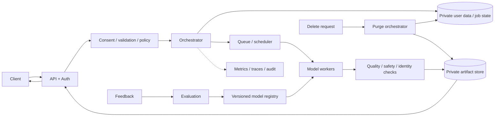
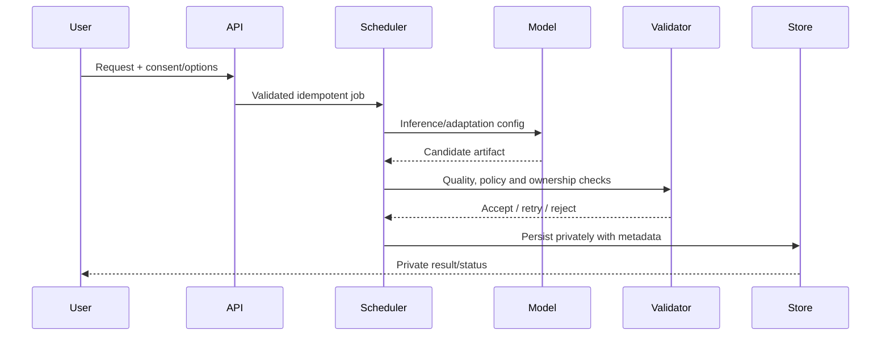
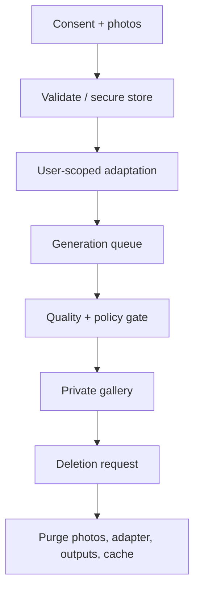

# tradeoffs — Personalized Headshot Generation

## Context
Professional headshots from consenting user's photos.

## Design decisions
- Model: diffusion base + per-user identity adapter/LoRA.
- Pipeline: consent/upload/validate → adapt → generate → private gallery → purge.
- Scaling: separate training/generation queues, scoped adapters and TTL.
- Evaluation: identity consistency, prompt adherence, consent and deletion verification.

## Architecture

## Sequence

## Data/API
Typed create/status/cancel/delete endpoints. Persist owner/tenant scope, consent record, model/adapter version, parameters, state, artifact refs, retention and purge status. Encrypt sensitive payloads; signed URLs expire. Keep user-specific adapters isolated.

## Reliability and operations
Separate long adaptation jobs from generation. Use GPU-aware scheduling, quotas, bounded retries, stage checkpoints and TTL. Deletion is an idempotent workflow across source photos, adapters/checkpoints, outputs, caches and indexes; reconcile until verified.

## Failure modes
| Failure | Mitigation |
|---|---|
| Consent/ownership unclear | block processing; verify user-controlled consent |
| Identity drift / poor output | quality evaluation, controlled prompts, bounded regeneration |
| Sensitive media leak | encryption, tenant isolation, short-lived URLs, access audit |
| GPU overload | queue, quotas, budget tiers, admission control |
| Incomplete deletion | tombstones, retryable purge, reconciliation report |
| Unsafe/abusive use | policy gates, rate limits, reporting and review |

## Trade-offs
Per-user adaptation improves consistency but adds GPU cost and sensitive artifacts. Scoped adapters/short retention reduce leakage risk but limit reuse. Async jobs improve resilience while requiring state and purge workflows. Consent and deletion are first-class requirements.

## Implementation / interview
Build consent-gated session API, private upload, queued adapter/model worker, generation workflow, private gallery, deletion orchestrator and purge tests. Explain data isolation, lifecycle, GPU scheduling and quality evaluation.

## Visual explainer

## References
- [ByteByteGo GenAI system design overview](https://bytebytego.com/courses/genai-system-design-interview/introduction-and-overview)
- [DreamBooth](https://arxiv.org/abs/2208.12242)
- [LoRA](https://arxiv.org/abs/2106.09685)

Original design; require consent and document retention.