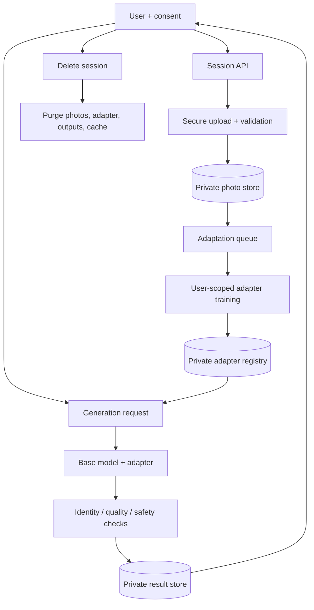
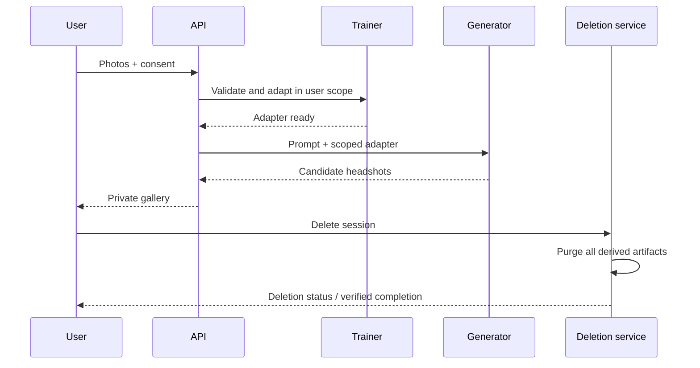

# Visual Explainer — Personalized Headshot Generation

## Mental model
A consent-gated workflow adapts a base model to the user's photos, generates requested styles in a private session, then supports verified deletion of all user-specific artifacts.

## Architecture

## Lifecycle

## Boundaries to call out
- Consent and ownership are checked before processing.
- User adapters are isolated and never shared across tenants.
- Source photos, checkpoints, adapters, outputs and caches have explicit retention.
- Deletion is an orchestrated, auditable workflow—not a single database delete.

## Interview drawing checklist
Show secure upload, consent record, adaptation queue, per-user adapter registry, generation queue, private output store, deletion orchestrator, purge reconciliation and GPU cost/quality metrics.

## References
- [ByteByteGo GenAI system design overview](https://bytebytego.com/courses/genai-system-design-interview/introduction-and-overview)
- [DreamBooth](https://arxiv.org/abs/2208.12242)
- [LoRA](https://arxiv.org/abs/2106.09685)

Original explainer; only use consenting users' images.