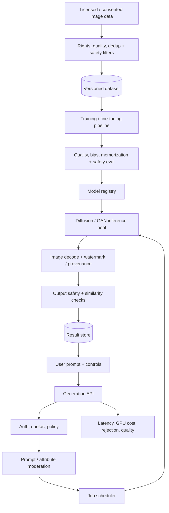
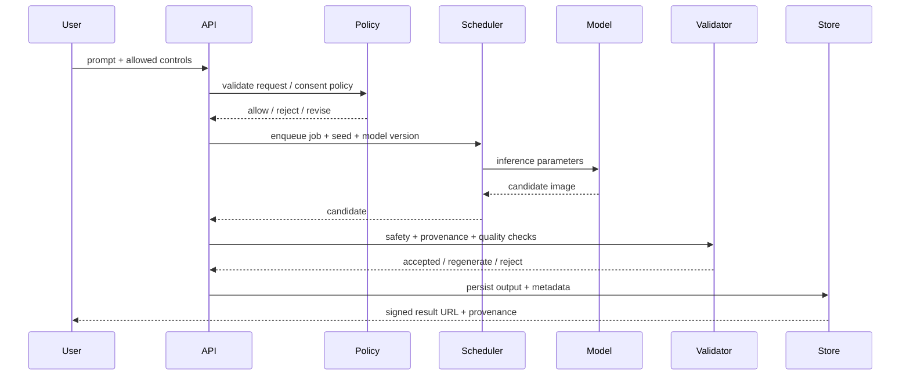

# Realistic Face Generation — GenAI System Design

## 1. Scope and safeguards

Generate synthetic, photorealistic faces for approved creative/research use. This design focuses on consented/licensed datasets, synthetic identities and abuse prevention. It excludes impersonation workflows and non-consensual likeness generation.

Requirements: controllable attributes within policy, high visual quality, scalable GPU inference, provenance, safety checks and model/data governance.

## 2. Architecture

## 3. Generation sequence

## 4. Model and data
- Model options: StyleGAN-family latent generation or diffusion models; diffusion offers flexible conditioning and iterative refinement, GANs may offer fast sampling.
- Dataset: explicit rights/consent, provenance, demographic balance, deduplication and removal workflows.
- Training: staged resolution, augmentation, regularization and controlled fine-tuning; avoid memorization of real individuals.
- Conditioning: synthetic attribute controls and style prompts; prevent identity matching or real-person targeting.
- Keep training manifests, model weights, evaluation reports and data lineage versioned.

## 5. Serving and storage
- `POST /v1/generations` returns job ID; `GET /v1/generations/{id}` status/result.
- Persist prompt policy decision, seed, model version, parameters, output hash, provenance and retention.
- Use object storage for outputs, metadata DB for jobs, queue for GPU scheduling.
- Signed URLs expire; outputs can be deleted and associated derived cache entries invalidated.

## 6. Scaling
- GPU workers autoscale on queue age and estimated denoising steps.
- Batch compatible requests; isolate high-resolution jobs.
- Use lower-resolution draft then optional upscaling; cap steps, dimensions and concurrent jobs.
- Cache only exact deterministic requests when privacy policy permits.
- Track GPU-seconds/job and cost per accepted output, not just request count.

## 7. Evaluation and safety
- Quality: FID/KID as dataset-level diagnostics, human preference and prompt adherence.
- Bias: evaluate demographic slices and attribute combinations; report gaps.
- Safety: prompt moderation, output classifier, similarity/memorization checks, provenance watermark/metadata.
- Abuse: rate limits, blocked impersonation/sexual exploitation requests, audit and incident response.
- Do not rely on a watermark as the sole safety control.

## 8. Failure modes
| Failure | Mitigation |
|---|---|
| Memorized training face | dedup, membership/memorization tests, dataset governance |
| Biased attribute coverage | balanced data, slice evaluation, human review |
| GPU overload | queue, quotas, lower-res fallback, admission control |
| Unsafe prompt/output | policy gates before and after inference |
| Model regression | versioned eval, canary, rollback |
| Provenance stripped | embed robust metadata where supported; preserve server-side record |

## 9. Interview extensions
- Real-time avatar generation: latency/quality trade-off and streaming frames.
- Controlled identity consistency for fictional characters across scenes.
- On-device generation and privacy-preserving inference.
- Synthetic data generation with downstream utility evaluation.

## 10. Portfolio build
Build a consented-data synthetic portrait demo using a model adapter, queued GPU worker, job status API, safety filters, provenance metadata and evaluation dashboard. Use a public model and document its license.

## References
- [ByteByteGo — GenAI System Design Interview](https://bytebytego.com/courses/genai-system-design-interview/introduction-and-overview)
- [StyleGAN2](https://arxiv.org/abs/1912.04958)
- [Denoising Diffusion Probabilistic Models](https://arxiv.org/abs/2006.11239)

Original architecture; use only licensed/consented data and synthetic identities.