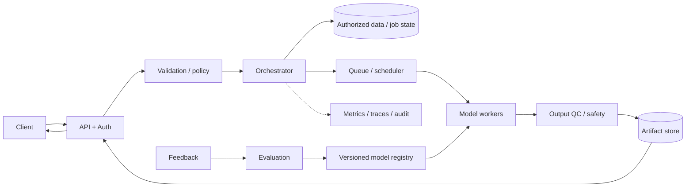
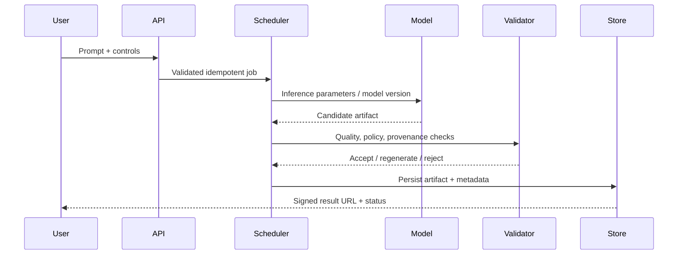
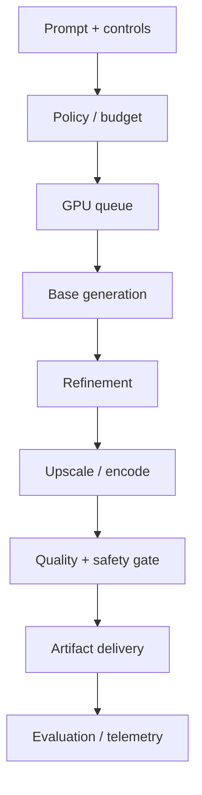

# visual explainer — Realistic Face Generation

## Context
Generate synthetic photorealistic faces with licensed/consented data and abuse controls.

## Design decisions
- Model/task: diffusion or StyleGAN family.
- Pipeline: policy/consent validation → queued generation → provenance and safety checks.
- Scaling: GPU queue by resolution/steps, quotas and tiered quality.
- Evaluation: human preference, bias slices, memorization and abuse testing.

## Architecture

## Sequence

## Data and API
Create async job endpoint and status/cancel endpoints. Persist prompt/options, seed, dimensions/duration, model and pipeline versions, stage state, compute budget, output hash, provenance and expiry. Store artifacts separately from relational job metadata.

## Reliability and operations
Estimate GPU budget before admission. Use stage-aware retries/checkpoints, bounded regeneration, cancellation, dead-letter handling and artifact TTL. Monitor queue age, GPU-seconds, OOM rate, accepted-output quality, safety outcomes and cost per successful output.

## Failure matrix
| Failure | Mitigation |
|---|---|
| GPU OOM / overload | memory-aware scheduler, lower tier, queue and quotas |
| Stage failure | checkpoint valid intermediates; retry stage idempotently |
| Low-quality artifact | bounded regeneration and quality gate |
| Unsafe prompt/output | pre/post moderation and policy review |
| Data rights / likeness abuse | provenance, consent/licensing, abuse controls |
| Version regression | eval gate, canary and rollback |

## Trade-offs
Async jobs add lifecycle complexity but protect API deadlines. Tiling lowers memory but can create seams; overlap and global conditioning help. Higher steps/resolution improve detail at greater cost. Keep intermediate artifacts short-lived.

## Implementation / interview
Implement typed job API, queue, model adapter/stub, artifact store, stage status, cancellation, quality checks and GPU-cost telemetry. Explain bottleneck, scheduling strategy, recovery and quality/cost tiers.

## Visual explainer

## References
- [ByteByteGo GenAI system design overview](https://bytebytego.com/courses/genai-system-design-interview/introduction-and-overview)
- [Latent Diffusion Models](https://arxiv.org/abs/2112.10752)

Original design and diagrams.