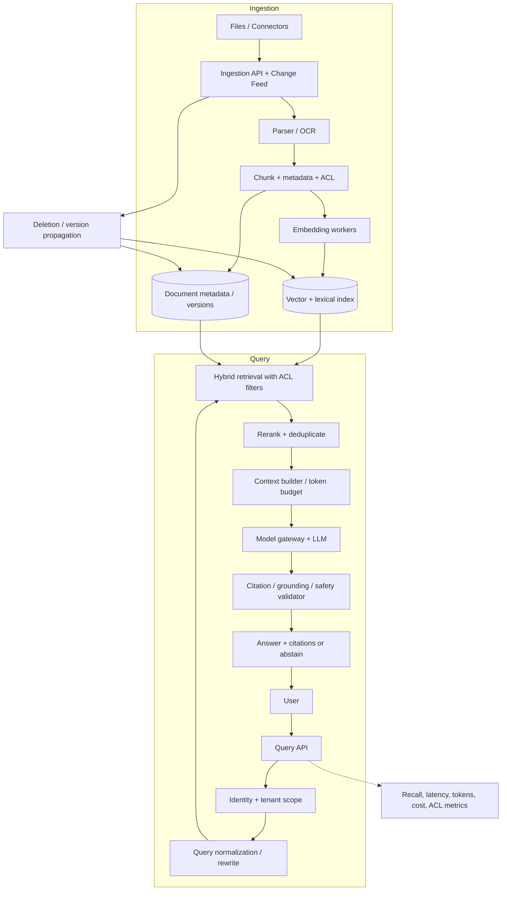
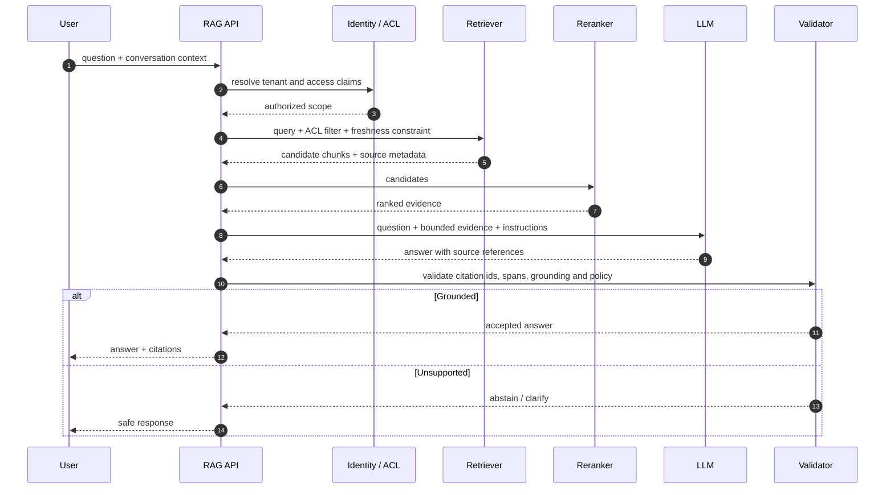

# Retrieval-Augmented Generation (RAG) — GenAI System Design

## 1. Goal and requirements

Answer questions grounded in a changing corpus with citations and access control. Separate ingestion freshness from interactive query latency.

- Ingest files, URLs and source connectors; parse, chunk, embed and index versioned content.
- Retrieve relevant evidence, enforce ACLs, rerank, generate a bounded answer and validate citations.
- Support updates/deletions, tenant isolation, observability, evaluation and safe abstention.

## 2. Architecture

## 3. Query sequence

## 4. Data model and contracts
- `Document(tenantId, sourceId, version, checksum, ACL, status, updatedAt)`
- `Chunk(documentId, version, chunkId, textRef, embedding, page/offset, ACL)`
- `IngestionJob(id, sourceId, version, state, retryCount)`
- `POST /v1/sources`, `POST /v1/query`, `DELETE /v1/sources/{id}`
- Every chunk carries tenant and authorization metadata; filter before context assembly, not only after retrieval.
- Versioned index writes are idempotent. Deletion creates tombstones and propagates to vector, lexical, cache and derived stores.

## 5. Retrieval decisions
- Hybrid vector + BM25/lexical search improves semantic and exact-term recall.
- Chunk by structure and semantic boundaries; preserve source/page/offset for citations.
- Rerank top candidates; deduplicate overlapping chunks; enforce token budget.
- Query rewrite and multi-query retrieval should be measured against latency and recall.
- Cache embeddings and retrieval results only with tenant, ACL, corpus version and query normalization in key.

## 6. Scaling and reliability
- Async ingestion queue with per-source concurrency, retries and dead-letter queue.
- Partition indexes by tenant/domain; hot shards and large tenants need isolation.
- Separate embedding and LLM GPU pools; batch embedding jobs.
- Use freshness SLOs, index lag monitoring and backfill workflows.
- Model/provider fallback; answer from evidence only or abstain if retrieval is unavailable.
- Rate-limit expensive query expansion and reranking.

## 7. Evaluation
- Retrieval: Recall@k, MRR/nDCG, coverage, freshness and ACL correctness.
- Generation: faithfulness, answer relevance, citation precision/recall, abstention quality.
- End-to-end: task success, latency p50/p95, tokens/query, cost/query, user feedback.
- Test adversarial documents, prompt injection, stale/deleted content and cross-tenant leakage.

## 8. Risks
| Risk | Mitigation |
|---|---|
| Retrieval miss | hybrid search, query rewrite, recall eval |
| Hallucinated citations | source-span validation, abstention |
| ACL leak | server-side filters, negative tests, tenant isolation |
| Prompt injection in corpus | treat chunks as untrusted data; tools use separate policy |
| Stale index | versioning, tombstones, freshness monitor |
| Cost explosion | context caps, rerank top-N, semantic cache with safe scope |

## 9. Interview extensions
- Multimodal RAG (OCR, image/audio embeddings).
- Graph RAG and entity linking.
- Streaming answer with citation assembly.
- Knowledge freshness from CDC and source webhooks.
- Agentic retrieval loops with bounded iteration budgets.

## 10. Portfolio build
Implement ingestion for Markdown/PDF, parser/chunker, embeddings, Postgres + pgvector and lexical search, ACL metadata, citations, golden-set evaluation, deletion propagation and a Breakscale workload.

## References
- [ByteByteGo — RAG chapter](https://bytebytego.com/courses/genai-system-design-interview/introduction-and-overview)
- [Retrieval-Augmented Generation](https://arxiv.org/abs/2005.11401)
- [OWASP LLM Top 10](https://owasp.org/www-project-top-10-for-large-language-model-applications/)

Original design and diagrams.