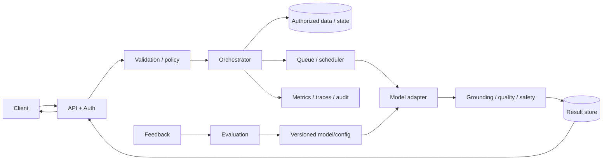
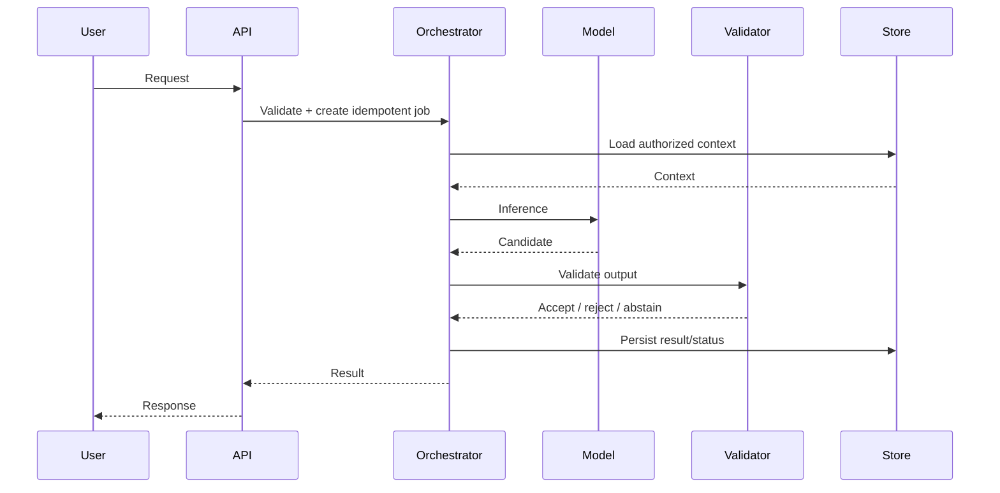
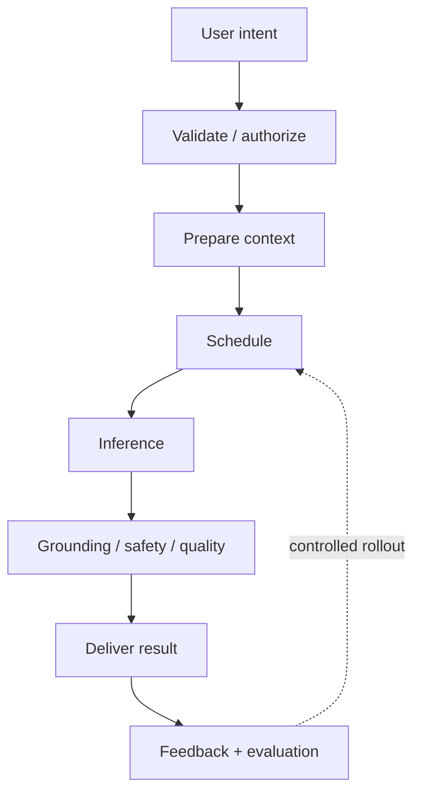

# architecture — RAG

## Context
Answer from authorized knowledge with citations.

## Design decisions
- Model/task: embeddings + hybrid retrieval + reranker + LLM.
- Processing: ingest/parse/chunk/embed/index; query/ACL-filter/retrieve/rerank/generate/validate.
- Scaling: async ingestion, partitioned indexes, freshness monitoring.
- Evaluation: Recall@k, nDCG, faithfulness, citation precision, ACL leakage.

## Architecture

## Sequence

## Data and contracts
Typed request/job/result; tenant scope, idempotency key, state, model/config version, timestamps, provenance and artifact refs. Relational metadata; encrypted object storage for large payloads. Enforce ACL before retrieval and define deletion propagation.

## Reliability and operations
Separate interactive p95 from async completion SLOs. Track queue age, model errors, quality, policy outcomes, cost/success and freshness. Use deadlines, cancellation, bounded retries, DLQ/redrive and rollback.

## Failure modes and mitigations
| Failure | Mitigation |
|---|---|
| Provider timeout / queue saturation | bounded retries, admission control, autoscaling, status endpoint |
| Duplicate work | idempotency key + execution ledger |
| Unsupported output | validator, bounded retry, abstention or human review |
| Data/ACL leak | server-side scope, tenant-keyed cache, audit and purge |
| Model regression | golden-set gate, canary, pinned version and rollback |

## Trade-offs
Sync only for bounded work; async for expensive tasks. Hybrid retrieval/model tiers improve quality and cost but add routing complexity. Cache only when privacy/freshness constraints permit. Keep policy outside the model.

## Implementation and interview plan
Build API + adapter/stub, persistence, worker, policy gates, eval fixtures and observability. Explain assumptions, first bottleneck, recovery, quality gate and scale trigger. Demonstrate request → result → feedback/evaluation.

## Visual explainer

## References
- [ByteByteGo GenAI system design overview](https://bytebytego.com/courses/genai-system-design-interview/introduction-and-overview)
- [RAG paper](https://arxiv.org/abs/2005.11401)

Original explanatory content and diagrams.