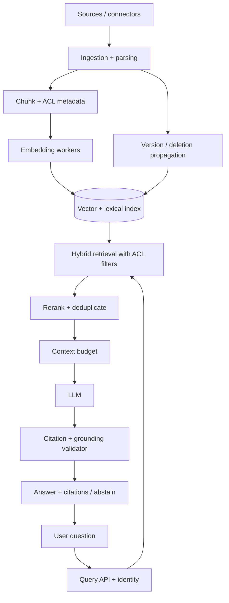
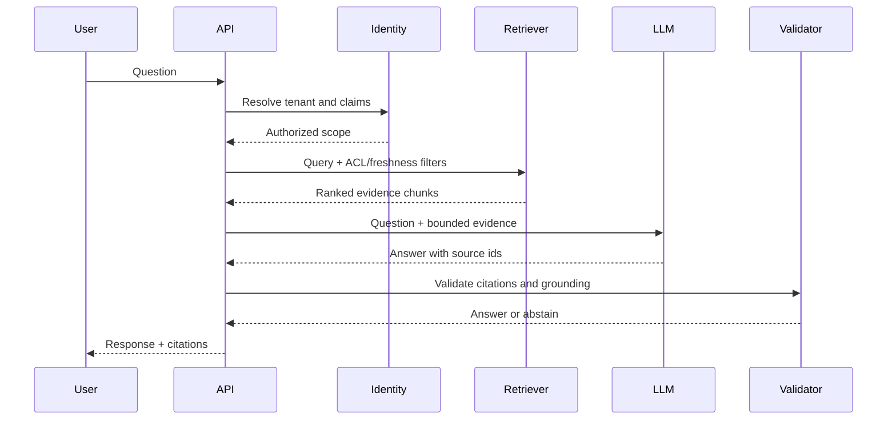

# Visual Explainer — Retrieval-Augmented Generation

## Mental model
RAG separates knowledge ingestion from question answering. The query path retrieves authorized evidence, ranks it, gives a bounded context to the model, then validates citations and grounding.

## Architecture

## Query sequence

## Explain the key boundaries
- Ingestion is asynchronous and versioned; query serving is latency-sensitive.
- ACL filtering happens server-side before evidence enters model context.
- Retrieved text is untrusted data, not instructions.
- Deletions propagate to vector/lexical indexes, caches and derived stores.
- The model proposes an answer; the validator checks source references and grounding.

## Interview drawing checklist
Show source connectors, parser/chunker, embedding pipeline, vector + lexical index, identity/ACL, reranker, context budget, LLM, citation validator, deletion propagation and recall/latency/cost metrics.

## References
- [ByteByteGo GenAI system design overview](https://bytebytego.com/courses/genai-system-design-interview/introduction-and-overview)
- [Retrieval-Augmented Generation paper](https://arxiv.org/abs/2005.11401)

Original explainer and diagrams.