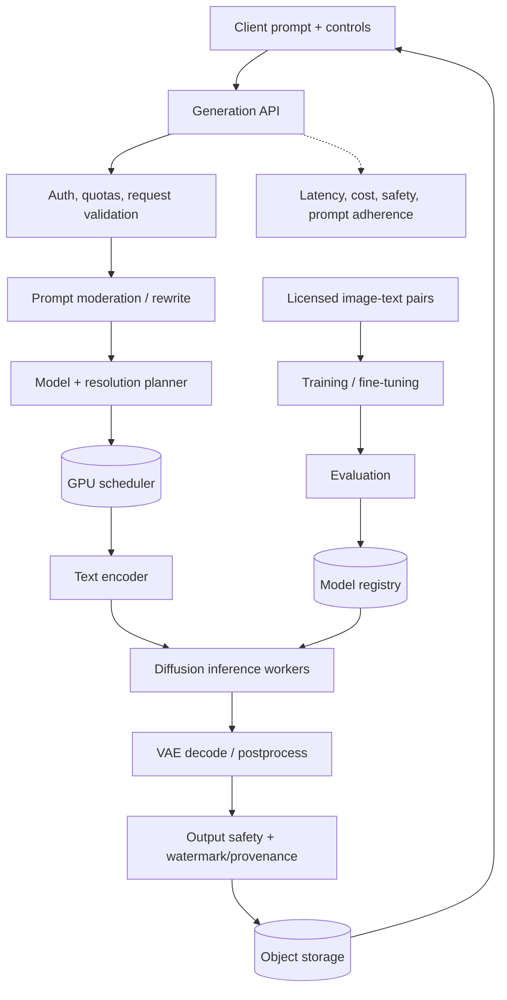
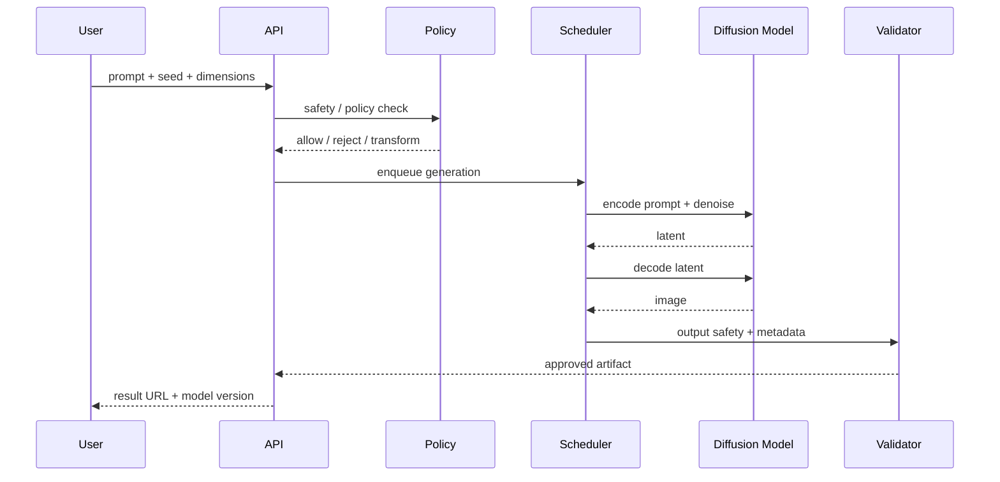

# Text-to-Image Generation — GenAI System Design

## 1. Problem framing

Convert a natural-language prompt and optional controls into one or more images. Design for quality, prompt adherence, safety, latency and GPU cost.

## 2. Architecture

## 3. Sequence

## 4. Model/data
- Latent diffusion is a practical baseline: text encoder, latent denoiser, VAE decoder.
- Training: licensed image-text pairs, caption quality filtering, deduplication, unsafe-content policy, source provenance.
- Fine-tuning: adapters/LoRA for styles or domains; version datasets and prompt templates.
- Conditioning: negative prompts, reference images, masks, control maps; validate each control path.
- Sampling: step count, guidance, scheduler and resolution are explicit quality/cost knobs.

## 5. API and data model
- `POST /v1/generations` → job ID; `GET /v1/generations/{id}` status and result.
- Store prompt, normalized prompt, seed, dimensions, model/adapter versions, safety decision, output hash and retention.
- Use object storage for image bytes; metadata DB for job lifecycle; queue for GPU jobs.
- Cache only deterministic requests with full model/config/seed key and policy-safe scope.

## 6. Scaling
- GPU queue scheduler considers VRAM, dimensions, steps, model residency and priority.
- Batch compatible requests where supported; keep interactive and bulk jobs separate.
- Autoscale based on queue age and GPU utilization; cap concurrent jobs and output count.
- Provide preview/standard/high-quality tiers; estimate cost before scheduling.
- Retry transient failures at stage boundaries; make job creation idempotent.

## 7. Evaluation
- Prompt adherence, human preference, diversity, image quality and safety.
- CLIP-based alignment is a diagnostic, not a sole quality gate.
- Evaluate prompt categories, languages, composition, text rendering and demographic slices.
- Online: acceptance/regeneration rate, latency, GPU-seconds/image, cost and moderation outcomes.

## 8. Safety and failure modes
| Risk | Mitigation |
|---|---|
| Unsafe prompt/output | input and output moderation, policy-based refusal |
| Bias / representation gaps | slice evaluation, dataset governance |
| Copyright/memorization | data provenance, dedup, memorization testing, policy |
| GPU saturation | queue, quotas, quality tiers, admission control |
| Model regression | eval gate, canary, rollback |
| Misleading provenance | metadata/watermark plus server-side records |

## 9. Interview extensions
- Inpainting/outpainting and image editing.
- Reference-image conditioning and style control.
- Text rendering with specialized modules.
- High-res generation and video extension.
- Private/on-device generation.

## 10. Portfolio build
Build an async diffusion API with model adapter, GPU worker, safety gate, provenance metadata, queue dashboard, evaluation prompts and cost telemetry.

## References
- [ByteByteGo — GenAI System Design Interview](https://bytebytego.com/courses/genai-system-design-interview/introduction-and-overview)
- [Denoising Diffusion Probabilistic Models](https://arxiv.org/abs/2006.11239)
- [Latent Diffusion Models](https://arxiv.org/abs/2112.10752)

Original design and diagrams.