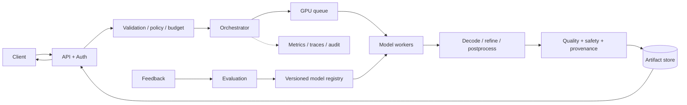
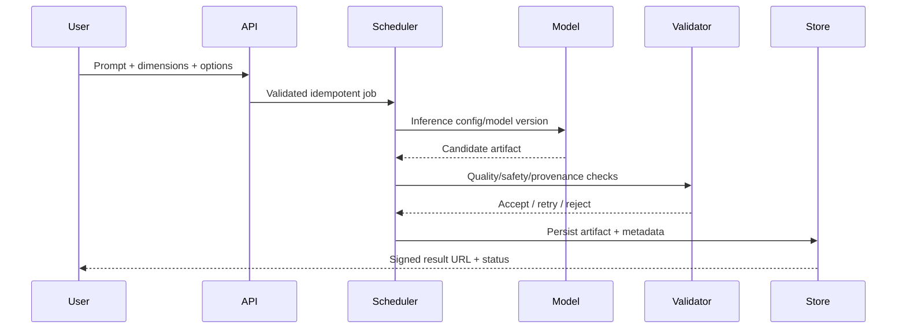
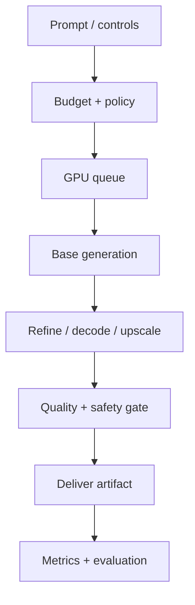

# architecture — Text-to-Image Generation

## Context
Prompt-conditioned image generation.

## Design decisions
- Model: latent diffusion: text encoder, denoiser, VAE.
- Pipeline: moderate prompt → schedule → denoise → decode → safety/provenance.
- Scaling: GPU queue, batching, quality tiers and quotas.
- Evaluation: prompt adherence, human preference, diversity and cost/image.

## Architecture

## Sequence

## API and data
Async create/status/cancel endpoints. Job metadata includes prompt/options, seed, resolution, model/config version, state, compute budget, output hash and expiry. Store media in object storage and lifecycle metadata in relational DB.

## Reliability and scaling
Estimate compute before admission; schedule by VRAM, steps and dimensions. Use stage-aware retries, cancellation, checkpoints and artifact TTL. Monitor queue age, GPU utilization/OOM, accepted-output quality and cost per successful image.

## Failure modes
| Failure | Mitigation |
|---|---|
| GPU saturation/OOM | memory-aware queue, quotas, lower quality tier |
| Stage failure | checkpoint and retry stage idempotently |
| Artifacts/seams | overlap/global conditioning, QC and bounded regeneration |
| Unsafe prompt/output | input and output policy checks |
| Model regression | golden eval, canary and rollback |
| Duplicate jobs | idempotency key and job ledger |

## Trade-offs
Async processing adds status/state complexity but avoids request timeouts. Higher resolution/steps improve detail at increased cost. Tiling saves VRAM but risks seams. Model tiers improve throughput but require evaluation-based routing.

## Implementation / interview
Build API, queue, model adapter/stub, artifact store, job lifecycle, QC gate and GPU cost dashboard. Discuss compute estimation, bottleneck, retry boundaries and tier selection.

## Visual explainer

## References
- [ByteByteGo GenAI system design overview](https://bytebytego.com/courses/genai-system-design-interview/introduction-and-overview)
- [Latent Diffusion Models](https://arxiv.org/abs/2112.10752)

Original design and diagrams.