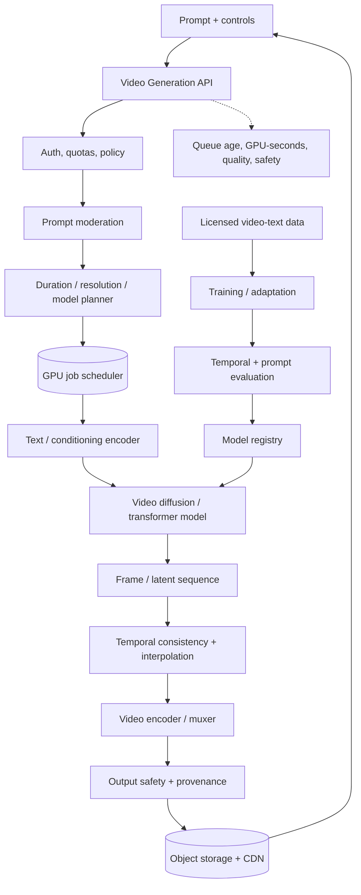
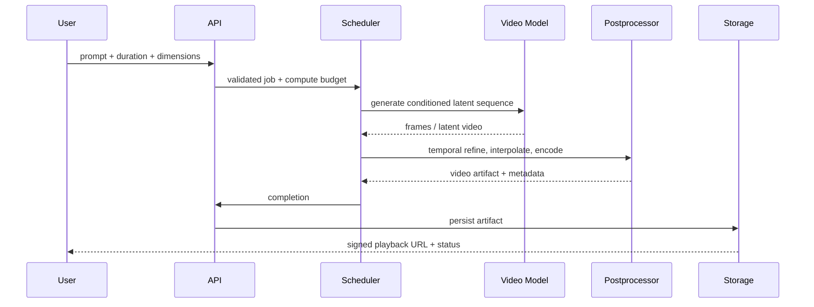

# Text-to-Video Generation — GenAI System Design

## 1. Problem framing

Generate a short video from a prompt, optionally with duration, aspect ratio, style and camera controls. Video generation is compute-intensive; design for asynchronous jobs, temporal coherence, safety and cost.

## 2. Architecture

## 3. Job sequence

## 4. Model and data
- Model families: latent video diffusion or spatiotemporal transformer/diffusion architectures.
- Conditioning: text, optional image reference, motion/camera controls; enforce clear boundaries for user-provided assets.
- Training data: licensed video-text pairs, temporal quality filters, duplicate detection, provenance and privacy review.
- Temporal coherence requires joint or windowed modeling across frames, not independent image generation.
- Store prompt, seed, frame rate, duration, dimensions, model version, sampler and postprocessing pipeline.

## 5. API and lifecycle
- `POST /v1/video-jobs` → job ID; `GET /v1/video-jobs/{id}`; cancel endpoint for queued/running jobs.
- State: `queued → conditioning → generating → refining → encoding → completed`; failure states include retryable stage and terminal error.
- Object storage holds intermediate chunks with TTL and final MP4/WebM; CDN serves completed output with signed access.
- Idempotency key prevents duplicate expensive jobs.

## 6. Scaling
- Estimate cost from duration × resolution × frame rate × steps/model tier.
- Queue by GPU memory and compute; separate preview, standard and high-quality tiers.
- Use chunked generation with overlap/context windows for longer clips; stitch with temporal consistency checks.
- Autoscale GPU workers based on queue age and GPU-seconds; cap per-user concurrency.
- Cancellation and partial previews reduce wasted compute; resume only from valid checkpoints.
- Encode on separate CPU/GPU pool to avoid starving generation.

## 7. Evaluation
- Prompt adherence, visual quality, temporal consistency, motion plausibility, flicker, identity/object persistence and safety.
- Metrics: human preference plus frame-level image metrics and temporal metrics (e.g., optical-flow consistency) as diagnostics.
- Slice by duration, motion type, scene complexity, text rendering and reference-image use.
- Online: completion rate, time-to-preview, cost/video-second, regeneration rate and moderation outcomes.

## 8. Failure modes
| Failure | Mitigation |
|---|---|
| Temporal flicker | temporal model/refiner, overlap windows, consistency evaluation |
| Long jobs timeout | staged state machine, checkpoints, async status |
| GPU OOM | planner, lower-resolution fallback, chunking |
| Encoding failure | retry encoding from persisted frames |
| Unsafe content | input and output moderation, reporting |
| Excessive cost | duration/step limits, tiering, budget estimate |
| Data leakage / memorization | provenance, dedup, privacy evaluation |

## 9. Interview extensions
- Image-to-video and video editing.
- Longer-form narrative with scene planning and continuity.
- Real-time streaming generation.
- Audio generation and synchronization.
- Distributed inference/model parallelism.

## 10. Portfolio build
Build an async video-job control plane around a model adapter: queue, staged status, cancellation, output storage/CDN, safety checks, cost estimator and temporal-quality benchmark.

## References
- [ByteByteGo — GenAI System Design Interview](https://bytebytego.com/courses/genai-system-design-interview/introduction-and-overview)
- [Video Diffusion Models](https://arxiv.org/abs/2204.03458)
- [Latent Diffusion Models](https://arxiv.org/abs/2112.10752)

Original architecture and diagrams.