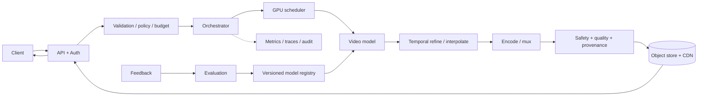
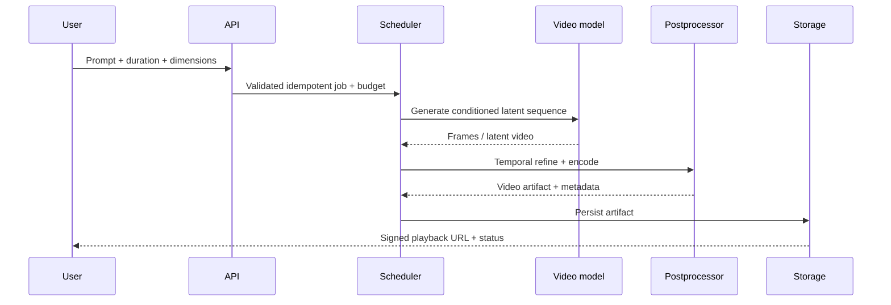
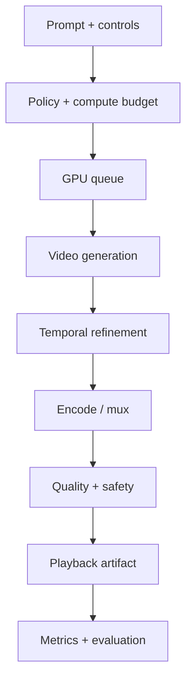

# tradeoffs — Text-to-Video Generation

## Context
Generate short prompt-conditioned videos with temporal coherence.

## Design decisions
- Model: video diffusion / spatiotemporal transformer.
- Pipeline: moderate → schedule → generate latent/frame sequence → temporal refine → encode.
- Scaling: GPU budget by duration/resolution/fps; staged async jobs.
- Evaluation: temporal consistency, flicker, motion plausibility, cost/video-second.

## Architecture

## Sequence

## API and data
Create/status/cancel endpoints. Store prompt/options, seed, frame rate, duration, dimensions, model/postprocess versions, stage state, compute budget, output hash and retention. Persist intermediate chunks with TTL; final video in object storage/CDN.

## Reliability and scaling
Estimate GPU cost from duration × resolution × fps × steps. Queue by memory/compute; separate preview/standard/high-quality tiers. Checkpoint stage boundaries, retry encoding independently, support cancellation and idempotent job creation. Monitor queue age, GPU-seconds, temporal quality, completion rate and cost/video-second.

## Failure modes
| Failure | Mitigation |
|---|---|
| Temporal flicker / drift | temporal model/refiner, overlap windows and consistency eval |
| GPU OOM / overload | planner, chunking, lower tier, admission control |
| Long job timeout | durable state machine, checkpoints, async status |
| Encoding failure | retry from persisted frames/chunks |
| Unsafe prompt/output | input/output policy and reporting |
| Excess cost | duration/step caps, estimate, quotas and tiering |

## Trade-offs
Joint temporal modeling improves coherence but is compute-heavy. Chunking enables longer clips but can introduce discontinuities. Higher fps/resolution increases cost sharply. Async jobs improve resilience but require progress, cancellation and artifact lifecycle.

## Implementation / interview
Build async job control plane, model adapter/stub, staged worker, output storage, status/cancel APIs, safety gate, cost estimator and temporal benchmark. Explain compute estimation, chunk boundaries, recovery and quality tiers.

## Visual explainer

## References
- [ByteByteGo GenAI system design overview](https://bytebytego.com/courses/genai-system-design-interview/introduction-and-overview)
- [Video Diffusion Models](https://arxiv.org/abs/2204.03458)

Original design and diagrams.