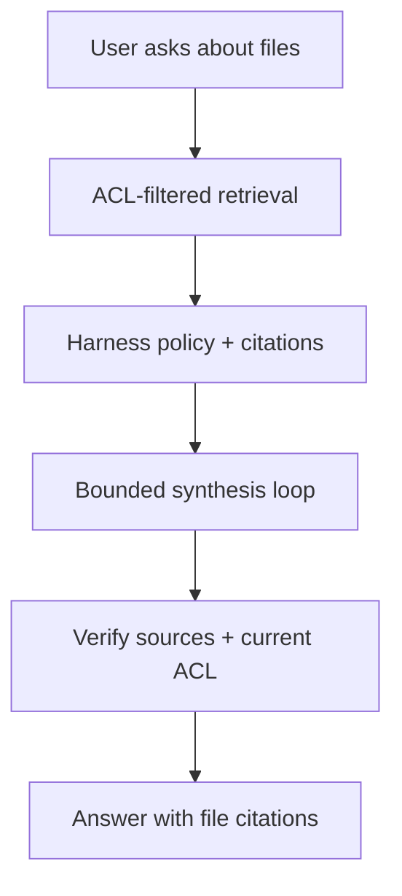

# AI / FDE Implementation — Google Drive

Use AI for document Q&A, summaries, classification and semantic search only over authorized files.

Prompt specifies task/output contract; Context retrieves ACL-filtered chunks with citations/version; Harness checks connector scopes, permissions, tool schemas and budgets; Loop is bounded and verifies evidence; Graph handles indexing, approval and export workflows.

Recheck permissions before returning content, honor deletion/retention, and treat document text as untrusted prompt injection. Never let generated output broaden share permissions.
