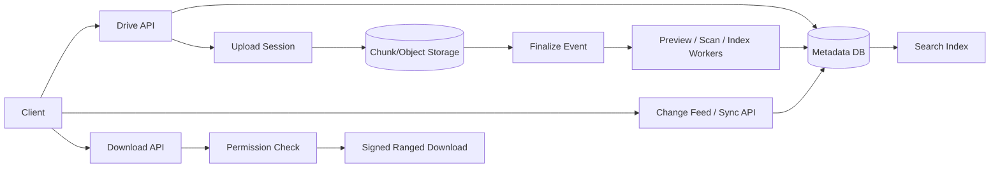
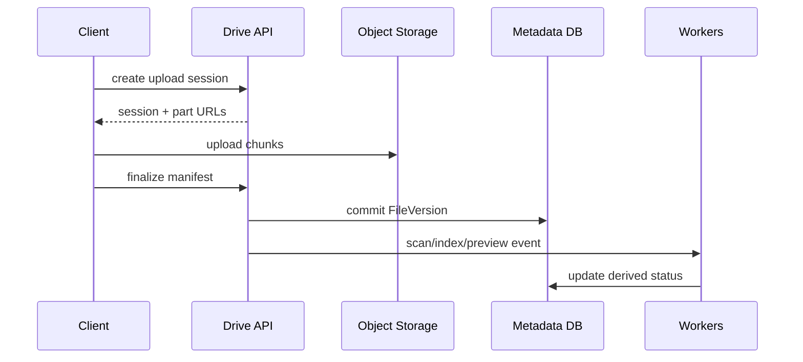

# Google Drive-Style File Storage

## Scope
Files/folders, resumable uploads, versions, sharing/ACL, sync clients, search, previews and deletion/restore.

## Architecture

## Critical flows
Upload chunks → checksum/manifest → atomic metadata version commit → async scan/preview/index → change feed. Download resolves file/version, checks ACL, issues short-lived ranged URL. Sync uses cursor and tombstones; permission changes invalidate shares/tokens.

## Data model
Drive, Folder, File, FileVersion, UploadSession, Chunk, Permission, ShareLink, SyncCursor, ChangeEvent. Blob bytes live in object storage; metadata and ACL are canonical.

## Failure modes
Partial upload, concurrent edits, permission revocation, malware scan failure, stale sync cursor, accidental deletion, duplicate chunk and signed URL expiry. Use resumable sessions, optimistic versioning, ACL recheck, quarantine, tombstones and cursor reset.

## Trade-offs
Chunk size vs retry overhead; global dedup vs privacy; SQL metadata vs distributed KV; sync frequency vs battery/network; immutable versions vs storage cost.

## Interview walkthrough
Clarify file sizes, sharing model, sync semantics, version history and collaboration scope. Estimate storage/ingress/egress. Explain chunked upload, metadata commit, ACL, sync cursor, versioning, deletion and restore.

## Visual explainer

## AI/FDE
AI may summarize documents, classify files or answer questions over user-authorized content. Prompt defines task; Context enforces ACL and provenance; Harness gates connectors/tools; Loop is bounded; Graph handles approvals and indexing workflows. Recheck permissions at retrieval and before sharing any generated output.
