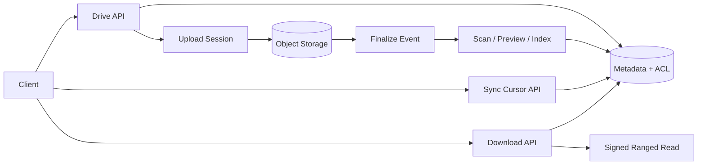

# Architecture — Google Drive-Style Storage

Drive API handles identity, metadata and ACL; upload service issues resumable sessions; object storage holds immutable chunks/versions; finalize commits manifest + FileVersion; workers scan, preview and index; change feed drives sync; download API checks ACL and issues short-lived ranged URLs.

Use metadata sharding by drive/file ID; keep large bytes out of relational rows. Change log/outbox ensures sync and derived indexes can replay. Version blobs are immutable; ACL remains authoritative.
