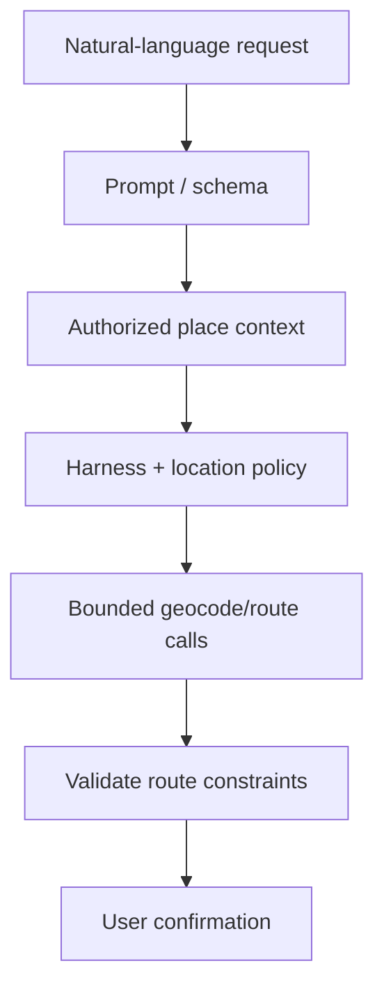

# AI / FDE Implementation — Google Maps

AI may parse natural-language destination requests, explain route alternatives or help plan multi-stop itineraries. Geocoding, routing, safety and navigation instructions remain deterministic.

Prompt outputs structured destination/constraints; Context includes user-authorized places and preferences; Harness scopes location tools and privacy; Loop is bounded with verification; Graph manages itinerary branches and user confirmations.

Never fabricate coordinates or route facts; validate every model-proposed place against geocoding and routing services. Minimize precise location retention.
