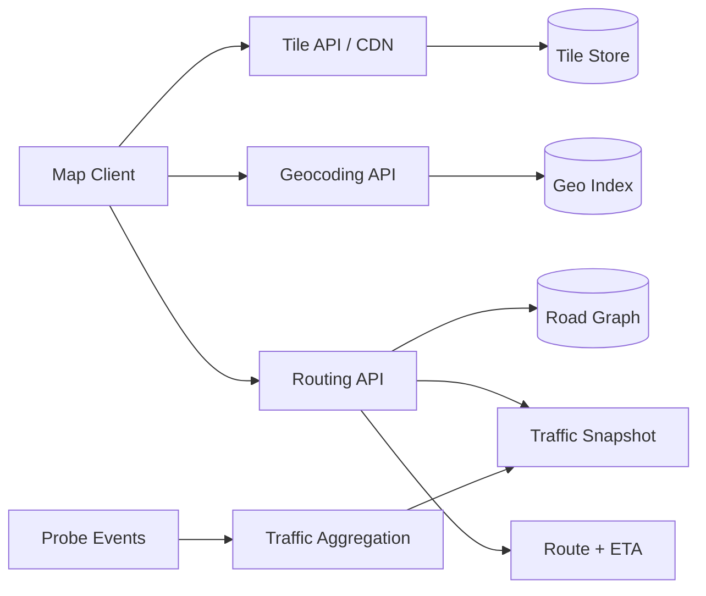
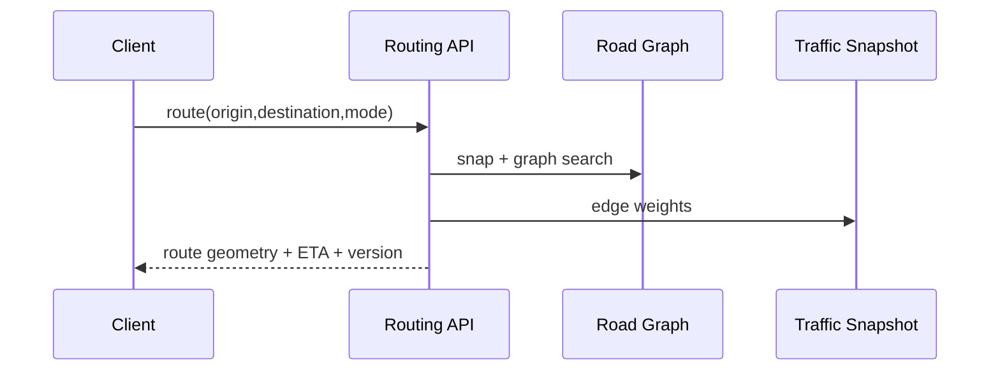

# Google Maps-Style Mapping Platform

## Scope
Map tiles, geocoding, places, route planning, traffic overlays, ETA and turn-by-turn navigation.

## Architecture

## Critical flow
Tile requests use zoom/x/y keys and CDN caching. Route request snaps endpoints to road graph, searches weighted edges (distance/time/traffic), returns route geometry/instructions and ETA. Probe events update traffic weights in time windows; navigation reroutes when material conditions change.

## Data model
TileKey, Place, GeoPoint, RoadSegment, RoadNode, RoadGraphVersion, RouteRequest, Route, RouteLeg, TrafficObservation, ClosureEvent.

## Failure modes
Stale tiles, graph-version mismatch, GPS drift, disconnected client, road closure lag, traffic spike and route recomputation storm. Version graph snapshots, timestamp traffic, use map matching, cache safe results and rate-limit reroutes.

## Trade-offs
Precomputed hierarchy vs dynamic routing; tile freshness vs CDN hit ratio; traffic precision vs privacy/compute; shortest vs fastest route; reroute responsiveness vs stability.

## Interview walkthrough
Clarify map scale, routing modes, ETA accuracy, traffic freshness and offline behavior. Estimate tile QPS and route QPS separately. Explain tile CDN, road graph, A*/Dijkstra or hierarchy, traffic updates, map matching and reroute triggers.

## Visual explainer

## AI/FDE
AI can interpret natural-language destinations or summarize route alternatives. Prompt defines structured intent; Context uses authorized location/search data; Harness applies privacy and tool scope; Loop is bounded; Graph handles itinerary planning. Routing and safety constraints remain deterministic and validated.
