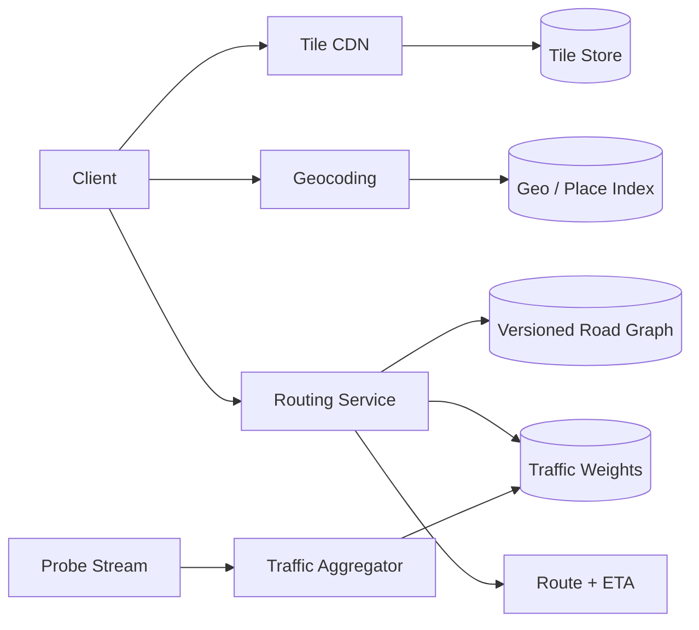

# Architecture — Google Maps

Tile service maps z/x/y to versioned vector/raster tiles and serves through CDN. Geocoding uses normalized address/place indexes. Routing service snaps coordinates to graph nodes, searches weighted edges, applies traffic/closure snapshot and returns route. Probe stream aggregates anonymized observations into time-window edge weights.

Use regional graph partitions and hierarchical routing for long distances; cache popular route/tiles with version-aware invalidation. Monitor route p99, graph build lag, traffic freshness, tile hit ratio, map-match confidence and reroute rate.
