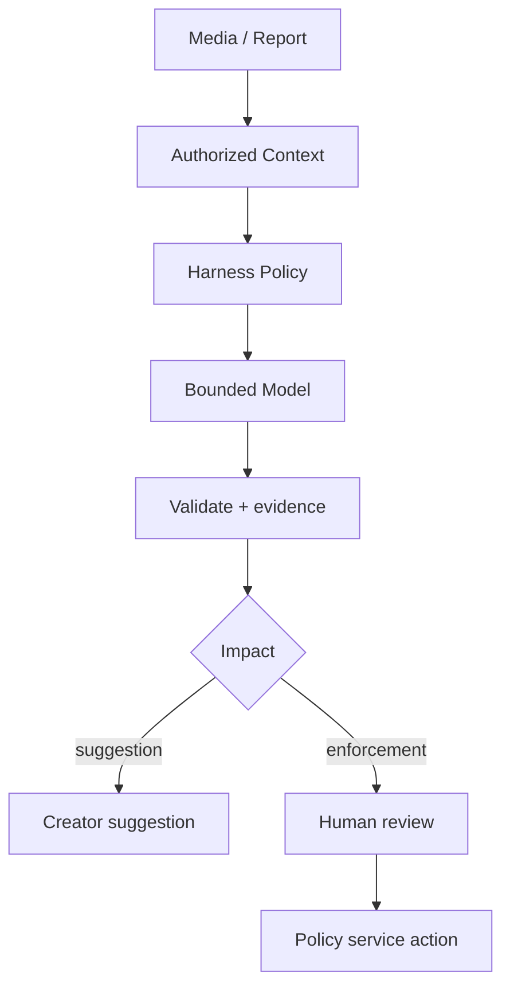

# AI / FDE Implementation — Instagram

AI assists caption drafts, alt-text, semantic discovery and moderation triage. Keep visibility, block rules, publication and enforcement in deterministic services.

Prompt: task/schema. Context: permission-filtered media metadata/transcript and policy provenance. Harness: tool scopes, privacy, quotas, audit. Loop: bounded propose/verify. Graph: human review, appeals and reprocessing checkpoints.

Treat captions/comments as untrusted input. Model outputs cannot bypass access control or independently remove accounts/content.
