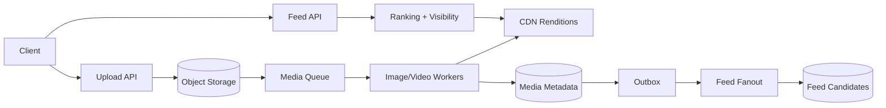
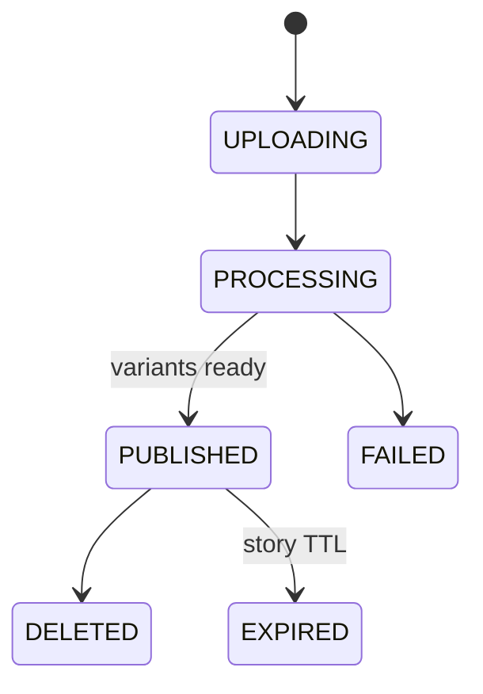

# Instagram-Style Media Network

Design photo/video publishing, stories, feeds, follows, likes/comments, notifications and privacy-aware media delivery.

## Architecture

## Flows
Upload → validate → generate variants/thumbnail → publish metadata → fanout candidate IDs. Feed → fetch candidates → hydrate canonical post/visibility → rank → return cursor page. Stories use expiry timestamps and lifecycle cleanup.

## Data model
User, MediaAsset, Post, Story(expiresAt), Follow, Comment, Like, FeedItem, OutboxEvent. Store blobs in object storage and metadata/relationships in transactional stores.

## Failure modes
Partial media processing, duplicate interactions, privacy changes, expired story still cached, deletion propagation, hot followers and abusive uploads. Use idempotency, readiness gates, read-time ACL, TTL cleanup and cache purge.

## Trade-offs
Precomputed vs on-demand feed; media variants vs storage; story TTL cleanup vs read-time expiry; ranking freshness vs latency.

## Interview walkthrough
Clarify media mix, feed freshness, story retention, privacy and follower skew. Estimate media ingest/storage and feed fanout. Explain upload pipeline, CDN, candidate generation, ranking, privacy enforcement and deletion.

## Visual explainer

## AI/FDE
AI may assist captioning, alt-text, semantic discovery and moderation triage. Prompt defines task; Context is ACL-filtered; Harness enforces privacy/policy; Loop is bounded; Graph routes uncertain enforcement to human review. Never let model output bypass visibility checks.
