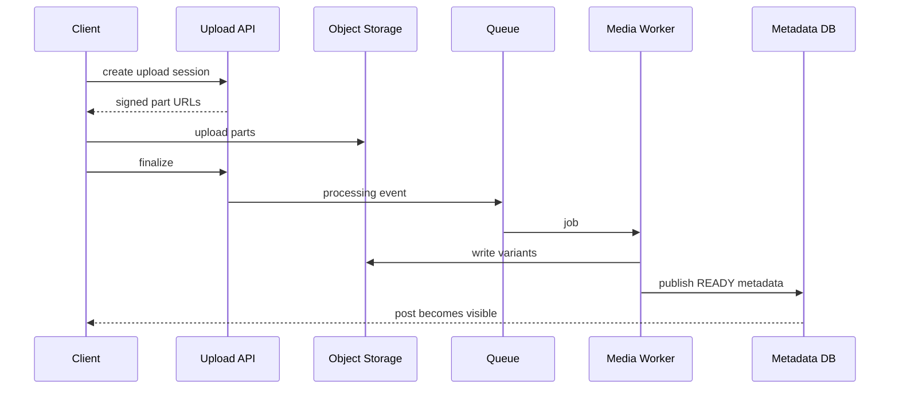

# Architecture — Instagram-Style Media Network

Upload service creates resumable sessions; object storage holds originals/variants; media workers produce thumbnails and encodings; metadata service owns publication/visibility; outbox drives feed and notification projections; feed service combines candidates, canonical visibility checks and ranking; CDN serves immutable media.

## Upload sequence

Scale media delivery with CDN; scale feed fanout by follower skew; partition relationship/feed data by user. Keep canonical ACL checks on feed hydration and direct media token issuance.

Observe upload completion, processing age, feed p99, CDN hit ratio, story expiry lag, privacy-filter rejects and fanout lag.
