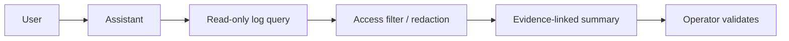

# AI / FDE Implementation

AI can summarize incidents and query authorized logs, but logs must be treated as untrusted input and tool access must be scoped.

Do not allow generated queries to bypass tenant/role filters. Avoid sending secrets or unnecessary raw log bodies to models. Evaluate summary accuracy, evidence coverage, sensitive-data leakage and cost.
