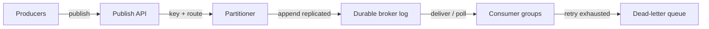
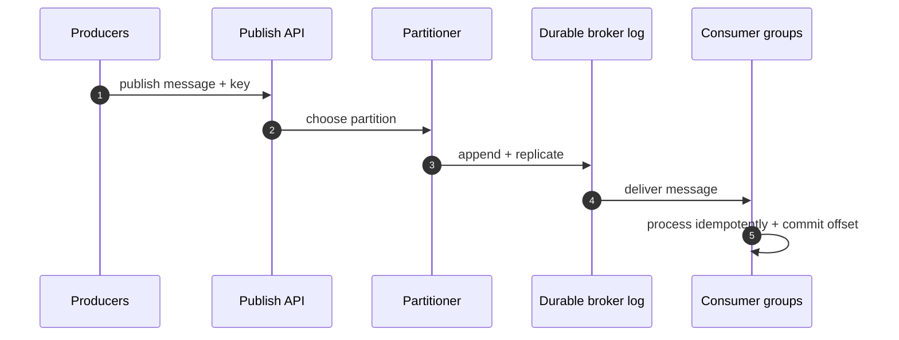
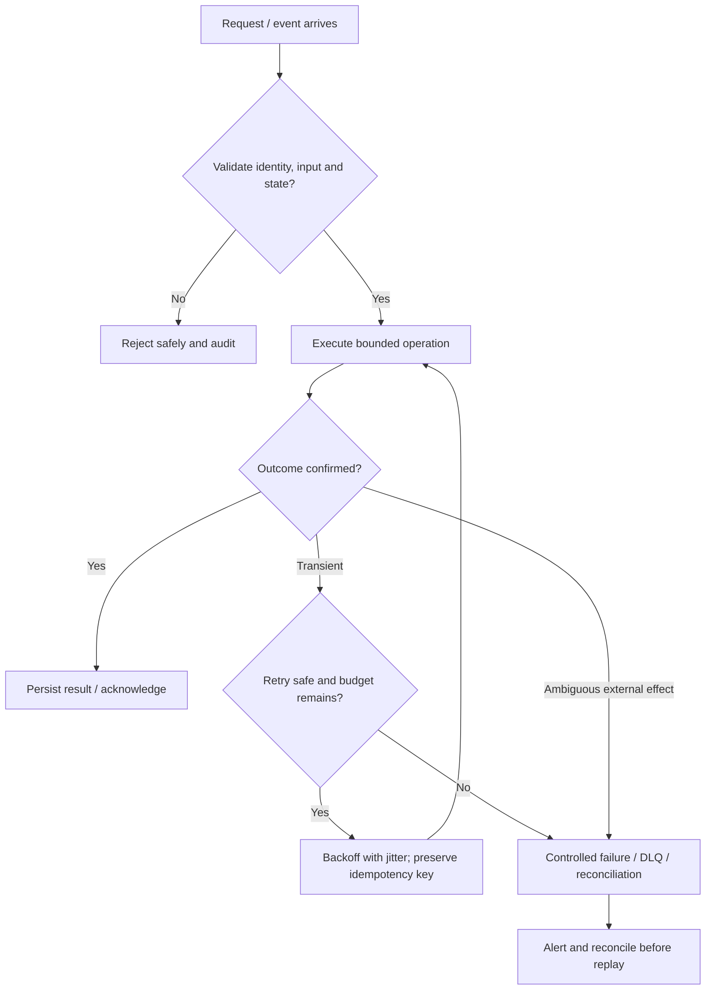

# Distributed Message Queue — Visual Architecture Explainer

> Conceptual HLD based on this repository's design notes. Confirm workload assumptions, service semantics and deployment choices before implementation.

## 1. System architecture

Follow the primary request path first. Storage, policy, queue and telemetry are supporting boundaries; they are not interchangeable.

## 2. Critical interaction

## 3. Failure and recovery

## 4. Core invariants

- Acknowledgement follows durable acceptance or committed consumer effect as defined.
- Consumers tolerate duplicate delivery.
- Ordering guarantees are scoped to partition/key, not assumed globally.

## 5. Architecture decisions to defend

- Clarify queue vs retained stream, ordering scope, throughput, retention, replay and consumer model.
- Explain partition key, replication, acknowledgements, consumer groups, offset/ack and delivery semantics.
- Walk publish → durable append → consumer process → commit; call out crash-after-effect-before-ack duplicate.

| Concern | AWS starting point | GCP starting point |
|---|---|---|
| Compute / API | API Gateway + ECS/Lambda as appropriate | API Gateway / Cloud Load Balancing + Cloud Run/GKE |
| Durable state | RDS/Aurora or DynamoDB based on access pattern | Cloud SQL/Spanner/Firestore based on access pattern |
| Async work | SQS/SNS/EventBridge/Kinesis as needed | Pub/Sub/Eventarc as needed |
| Operations | CloudWatch, X-Ray, IAM, Secrets Manager | Cloud Logging/Monitoring/Trace, Cloud IAM, Secret Manager |

These are starter mappings, not exact equivalents. Choose services from required consistency, ordering, retention, latency, regional scope and operational constraints.

## 6. Senior interview walkthrough (10 minutes)

### 0:00–1:00 — Frame the problem
Clarify queue vs retained stream, ordering scope, throughput, retention, replay and consumer model.

### 1:00–2:00 — Requirements and invariants
Explain partition key, replication, acknowledgements, consumer groups, offset/ack and delivery semantics.

### 2:00–4:00 — Draw and narrate the architecture
Walk publish → durable append → consumer process → commit; call out crash-after-effect-before-ack duplicate.

### 4:00–6:00 — Walk the critical path
Design retry tiers, backoff, poison-message handling, DLQ, replay and schema evolution.

### 6:00–8:00 — Failure, recovery and operations
Failure cases: broker node loss, hot partition, consumer lag, poison message, rebalance and downstream throttling.

### 8:00–9:00 — Trade-offs and alternatives
Trade-offs: ordering vs parallelism; retention vs storage cost; at-least-once vs dedupe complexity.

### 9:00–10:00 — Close with measurable signals
Name the SLOs and operational signals that demonstrate correctness and capacity: user-visible latency/error rate, saturation, queue age/lag where applicable, retry/duplicate rate, and domain success metrics. State what would trigger a redesign rather than claiming unlimited scale.

## 7. Follow-up questions to rehearse

- How do you preserve order?
- What happens after consumer crash?
- How do you handle poison messages?
- How do you scale lagging consumers?

## Archify source

Editable Archify diagram IR: archify/message-queue.architecture.json. Generate the interactive HTML with the Archify skill/CLI from the repository root. The Mermaid diagrams above render directly on GitHub.
