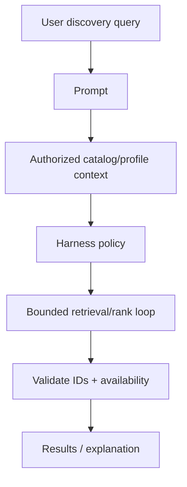

# AI / FDE Implementation — Netflix

AI assists natural-language catalog search, synopsis generation, discovery explanations and support triage. Entitlement, region availability, DRM and playback control remain deterministic.

Prompt defines output contract; Context retrieves authorized catalog/profile signals with consent; Harness scopes tools and budget; Loop bounds ranking/explanation; Graph handles editorial review and experiments.

Model output must reference canonical title IDs and pass region/entitlement filters before presentation.
