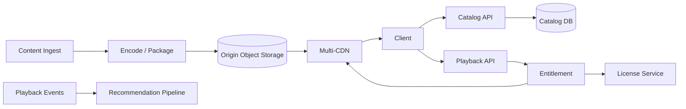
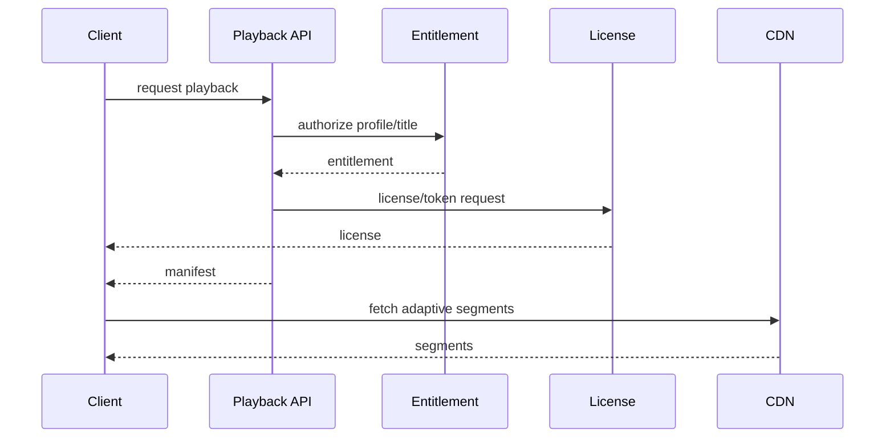

# Netflix-Style Streaming Platform

## Scope
Catalog, profiles, search, entitlement, playback sessions, manifests, DRM/license, recommendations and global CDN delivery.

## Architecture

## Flows
Ingest master → encode bitrate/codec ladder → package/encrypt → publish catalog metadata. Playback resolves title/profile → entitlement check → short-lived manifest/license → adaptive segments from CDN → progress heartbeat.

## Data model
Profile, Title, Episode, Entitlement, PlaybackSession, Manifest, LicenseRequest, PlaybackProgress, DeviceSession, ContentVersion.

## Failure modes
CDN regional outage, origin overload, token/license expiry, DRM provider outage, codec incompatibility, hot premiere and entitlement inconsistency. Use multi-CDN routing, origin shielding, retries with deadline, license failover and admission controls.

## Trade-offs
Multi-CDN complexity vs resilience; pre-positioning vs storage; encode ladder vs cost; online recommendations vs latency; license security vs startup time.

## Interview walkthrough
Clarify global concurrency, device/codec support, subscription rules, startup/rebuffer SLO and content windows. Estimate egress and segment QPS. Explain ingest pipeline, entitlement, manifest, CDN, DRM, failover and recommendations.

## Visual explainer

## AI/FDE
AI supports discovery, synopsis personalization and support triage. Prompt defines recommendation/explanation output; Context uses authorized catalog/profile signals; Harness enforces consent and tool scope; Loop is bounded; Graph coordinates editorial review. Playback authorization and DRM decisions remain deterministic.
