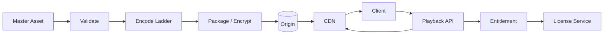

# Architecture — Netflix-Style Streaming

Content pipeline validates masters, encodes a rendition ladder, packages DRM-compatible segments and publishes immutable manifests. Catalog service owns metadata and availability windows. Playback API checks profile entitlement and device limits, obtains license/token, and returns manifest. CDN serves segments; telemetry feeds QoE and recommendation pipelines.

Use regional origins, multi-CDN steering and origin shielding. Separate playback control-plane APIs from high-volume segment delivery. Monitor startup time, rebuffer ratio, bitrate, CDN hit ratio, license errors and regional availability.
