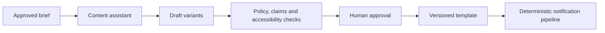

# AI / FDE Implementation

AI may draft message variants or summarize delivery incidents. It must not select recipients, override consent or invent claims.

Use no-send sandbox tools for drafts. Production sends require consent checks, approved template version, recipient scope, rate caps and audit. Evaluate factuality, opt-out compliance and engagement guardrails.