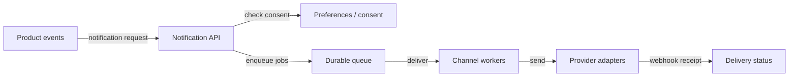
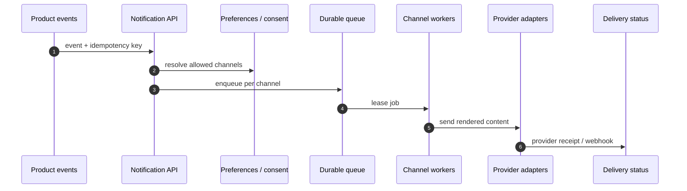
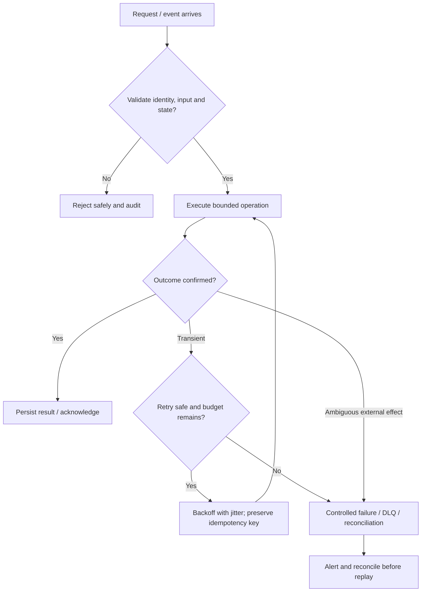

# Notification Platform — Visual Architecture Explainer

> Conceptual HLD based on this repository's design notes. Confirm workload assumptions, service semantics and deployment choices before implementation.

## 1. System architecture

Follow the primary request path first. Storage, policy, queue and telemetry are supporting boundaries; they are not interchangeable.

## 2. Critical interaction

## 3. Failure and recovery

## 4. Core invariants

- Consent is checked at enqueue and rechecked before send where policy requires.
- Retries use stable notification/provider idempotency keys.
- Provider acceptance is not equivalent to end-user delivery.

## 5. Architecture decisions to defend

- Clarify channels, delivery target (accepted vs delivered), urgency, localization, preferences and consent.
- Design intake, dedupe, preference evaluation, fanout, queue, template renderer, adapters and status store.
- Walk event → consent check → recipient/channel job → render → provider send → webhook/status update.

| Concern | AWS starting point | GCP starting point |
|---|---|---|
| Compute / API | API Gateway + ECS/Lambda as appropriate | API Gateway / Cloud Load Balancing + Cloud Run/GKE |
| Durable state | RDS/Aurora or DynamoDB based on access pattern | Cloud SQL/Spanner/Firestore based on access pattern |
| Async work | SQS/SNS/EventBridge/Kinesis as needed | Pub/Sub/Eventarc as needed |
| Operations | CloudWatch, X-Ray, IAM, Secrets Manager | Cloud Logging/Monitoring/Trace, Cloud IAM, Secret Manager |

These are starter mappings, not exact equivalents. Choose services from required consistency, ordering, retention, latency, regional scope and operational constraints.

## 6. Senior interview walkthrough (10 minutes)

### 0:00–1:00 — Frame the problem
Clarify channels, delivery target (accepted vs delivered), urgency, localization, preferences and consent.

### 1:00–2:00 — Requirements and invariants
Design intake, dedupe, preference evaluation, fanout, queue, template renderer, adapters and status store.

### 2:00–4:00 — Draw and narrate the architecture
Walk event → consent check → recipient/channel job → render → provider send → webhook/status update.

### 4:00–6:00 — Walk the critical path
Explain provider quotas, retries, idempotency, fallback channels and opt-out race semantics.

### 6:00–8:00 — Failure, recovery and operations
Failure cases: provider outage, duplicate webhook, invalid address, consent revoked after enqueue and queue backlog.

### 8:00–9:00 — Trade-offs and alternatives
Trade-offs: multi-channel fanout vs cost; provider failover vs duplicate sends; delivery latency vs retry policy.

### 9:00–10:00 — Close with measurable signals
Name the SLOs and operational signals that demonstrate correctness and capacity: user-visible latency/error rate, saturation, queue age/lag where applicable, retry/duplicate rate, and domain success metrics. State what would trigger a redesign rather than claiming unlimited scale.

## 7. Follow-up questions to rehearse

- How do you honor opt-out immediately?
- How do you prevent duplicate sends?
- How do you handle provider outage?
- How do you prioritize urgent messages?

## Archify source

Editable Archify diagram IR: archify/notification-system.architecture.json. Generate the interactive HTML with the Archify skill/CLI from the repository root. The Mermaid diagrams above render directly on GitHub.
