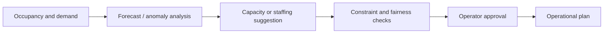

# AI / FDE Implementation

AI can forecast occupancy, explain anomalies and assist operators. Allocation, pricing rules and payment execution remain deterministic.

Do not let an agent assign physical spots or collect payment directly. Evaluate forecast error, occupancy mismatch and operational outcomes.
